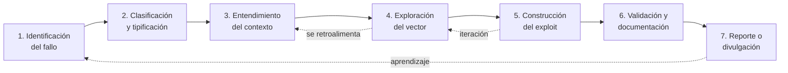

# Metodología de análisis de vulnerabilidades y desarrollo de exploits

> **Máster en Ciberseguridad — Módulo 6: Vulnerabilidades**
> Propuesta técnica personal sobre cómo abordar el análisis de vulnerabilidades,
> el desarrollo de exploits y la investigación de 0days.
> Autor: **Jonathas** · [@DateUnH4ck](https://www.youtube.com/@DateUnH4ck)

---

## 📌 De qué va este proyecto

Este repositorio **no es un write-up de una máquina concreta**. Es la documentación de una
**metodología propia y reproducible** para enfrentarse a una vulnerabilidad en software real:
desde el momento en que se detecta un comportamiento anómalo hasta que se construye, valida
y documenta un exploit funcional, con especial atención a la investigación de **vulnerabilidades
desconocidas (0days)**.

Está escrito con una idea en mente: que **otro analista pueda aprender de él**. Por eso cada
decisión técnica va acompañada de su *por qué*, cada herramienta se sitúa en la fase donde
realmente aporta, y el bloque práctico puede **reproducirse paso a paso** en un laboratorio propio.

El proyecto acompaña al Módulo 6 del Máster en Ciberseguridad (CIBERSEGURIDAD / ENIIT / UCAM) y
reconstruye, con enfoque de analista, el camino *"del fallo al exploit"* que plantea el manual.

---

## 🧭 Índice del documento

El documento principal está dividido en capítulos dentro de [`docs/`](docs/) para que sea fácil
de leer, navegar y enlazar:

| # | Capítulo | Contenido |
|---|----------|-----------|
| 1 | [Metodología de análisis](docs/01-metodologia.md) | Ciclo de vida, las 7 fases del análisis, mentalidad del analista |
| 2 | [Mecanismos de protección](docs/02-mecanismos-proteccion.md) | ASLR, DEP/NX, Stack Canaries, CFG, SafeSEH, SecureBoot, DSE, PatchGuard |
| 3 | [El arsenal: herramientas](docs/03-arsenal-herramientas.md) | Mapeo, escáneres, fuzzing, reversing, diffing y reporting por fase |
| 4 | [Caso práctico: del fallo al exploit](docs/04-caso-practico.md) | Stack Buffer Overflow completo, reproducible en el laboratorio |
| 5 | [Casos reales (CVE) investigados](docs/05-casos-reales-cve.md) | Análisis de CVEs públicas con el patrón de la metodología |
| 6 | [Mi aproximación a los 0days](docs/06-aproximacion-0days.md) | Flujo de investigación: fuzzing, diffing, reversing, entorno |
| 7 | [Bastionado y defensa](docs/07-bastionado-defensa.md) | Perspectiva Blue Team / SOC: cómo se rompe la cadena de explotación |
| 8 | [Conclusiones](docs/08-conclusiones.md) | Qué he aprendido y cómo evoluciona esta metodología |
| 9 | [Bibliografía y recursos](docs/09-bibliografia.md) | Fuentes, estándares, cursos y lecturas de referencia |

👉 El **laboratorio práctico** (código vulnerable, versión corregida, fuzzer, cálculo de offset
y plantilla de exploit) está en [`labs/`](labs/) con su propio [README](labs/README.md) y los
comandos para reproducir cada captura.

---

## 🗺️ La metodología en una imagen



> Las fases **no son lineales**: se retroalimentan. Un hallazgo en la fase de exploración puede
> obligar a revisar el contexto, y la construcción del exploit casi siempre hace volver al
> análisis del crash. Esa iteración es la metodología.

---

## 🎯 A quién va dirigido

- Analistas que empiezan en **análisis de vulnerabilidades / exploit development**.
- Perfiles **Blue Team / SOC** que quieren entender la ofensiva para defender mejor
  (entender cómo se construye un exploit es la mejor forma de saber qué telemetría buscar).
- Reclutadores y entrevistadores técnicos: este repo es una **evidencia de proceso**, no solo de resultado.

---

## ⚖️ Aviso ético y de alcance

Todo el material práctico de este repositorio se ejecuta sobre **código deliberadamente vulnerable
escrito y compilado por mí**, dentro de un **laboratorio aislado** y de uso personal. El objetivo es
estrictamente **educativo y defensivo**: comprender la mecánica de los fallos de memoria para poder
detectarlos, mitigarlos y responder ante ellos.

- No se incluye malware, ni exploits dirigidos contra sistemas o personas reales.
- Las CVEs del capítulo 5 se analizan a partir de **información pública** (NVD, avisos del fabricante,
  write-ups ya publicados), sin armar un exploit funcional contra terceros.
- Este conocimiento se usa dentro del marco legal y de la ética profesional (autorización previa,
  *responsible disclosure*).

---

## 🛠️ Cómo usar este repositorio

```bash
# 1. Clonar
git clone https://github.com/dat3unh4ck/modulo6-analisis-vulnerabilidades.git
cd modulo6-analisis-vulnerabilidades

# 2. Leer el documento (empezar por docs/01-metodologia.md)
#    o directamente este README como portada.

# 3. Montar el laboratorio práctico
cd labs
cat README.md      # instrucciones de compilación y explotación
```

---

## 📄 Licencia

Publicado con fines educativos bajo licencia [MIT](LICENSE). El uso de las técnicas aquí descritas
es responsabilidad de quien las aplica y debe limitarse a entornos autorizados.
