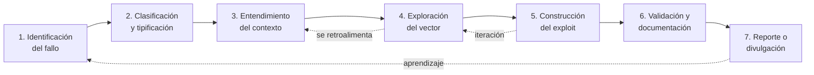

# Análisis de vulnerabilidades y desarrollo de exploits

Trabajo del Módulo 6 del Máster en Ciberseguridad. En vez de resumir el manual,
escribí cómo abordo yo una vulnerabilidad en software: desde que un programa
empieza a fallar de forma rara hasta tener un exploit que funciona y que
entiendo, incluida la parte de buscar fallos que nadie ha reportado todavía
(0days).

No busco documentar una máquina de CTF concreta, sino el método: las fases por
las que paso, qué herramienta uso en cada una y por qué, y un laboratorio que se
monta y se reproduce entero. Viene del Módulo 6 (CIBERSEGURIDAD / ENIIT / UCAM) y
sigue el camino "del fallo al exploit" del temario, pero contado desde el lado
del que lo investiga.

Autor: Jonathas · canal [@DateUnH4ck](https://www.youtube.com/@DateUnH4ck)

## Índice

El documento está partido en capítulos dentro de [`docs/`](docs/):

| # | Capítulo | Contenido |
|---|----------|-----------|
| 1 | [Metodología de análisis](docs/01-metodologia.md) | Ciclo de vida, las 7 fases, mentalidad del analista |
| 2 | [Mecanismos de protección](docs/02-mecanismos-proteccion.md) | ASLR, DEP/NX, stack canaries, CFG, SafeSEH, SecureBoot, DSE, PatchGuard |
| 3 | [Herramientas](docs/03-arsenal-herramientas.md) | Mapeo, escáneres, fuzzing, reversing, diffing y reporting por fase |
| 4 | [Caso práctico: del fallo al exploit](docs/04-caso-practico.md) | Un stack buffer overflow completo, reproducible |
| 5 | [Casos reales (CVE)](docs/05-casos-reales-cve.md) | CVE públicas analizadas con el mismo patrón |
| 6 | [Aproximación a los 0days](docs/06-aproximacion-0days.md) | Fuzzing, diffing, reversing, montaje del entorno |
| 7 | [Bastionado y defensa](docs/07-bastionado-defensa.md) | Lado Blue Team: dónde se rompe la cadena de explotación |
| 8 | [Conclusiones](docs/08-conclusiones.md) | Qué saqué en claro |
| 9 | [Bibliografía](docs/09-bibliografia.md) | Fuentes, estándares y lecturas |

El laboratorio (código vulnerable, versión corregida, fuzzer, cálculo de offset
y plantilla de exploit) está en [`labs/`](labs/), con su propio
[README](labs/README.md) y los comandos para reproducir cada paso.

## El flujo



Las fases no van en línea recta. Un hallazgo en la exploración te manda de vuelta
al contexto, y construir el exploit casi siempre te hace volver a mirar el crash.
Esa ida y vuelta es la parte que no sale en los esquemas limpios.

## Alcance y ética

Todo lo práctico corre sobre código que escribí yo a propósito inseguro, en una
VM aislada. El objetivo es entender cómo funcionan los fallos de memoria para
saber detectarlos y cortarlos. Las CVE del capítulo 5 las analizo solo con
información pública (NVD, avisos del fabricante, write-ups ya publicados): no armo
un exploit funcional contra sistemas de terceros. Fuera del laboratorio, esto
solo se toca con autorización y responsible disclosure.

## Montarlo

```bash
git clone https://github.com/dat3unh4ck/modulo6-analisis-vulnerabilidades.git
cd modulo6-analisis-vulnerabilidades

# Documento: empieza por docs/01-metodologia.md
# Laboratorio:
cd labs && cat README.md
```

## Licencia

MIT. Las técnicas que hay aquí son responsabilidad de quien las use, y solo en
entornos autorizados.
