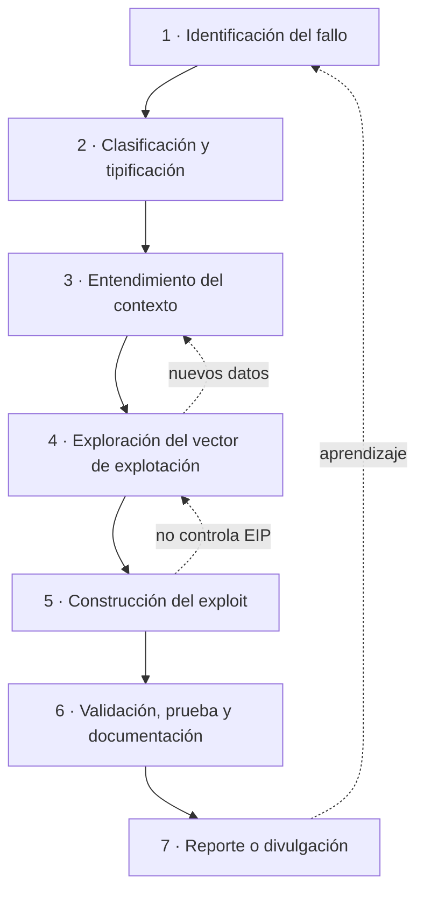

# 1. Metodología de análisis de vulnerabilidades

> *"No se espera de ti únicamente que ejecutes exploits públicos; se espera que
> seas capaz de construir una metodología sólida de análisis."* — Enunciado del Módulo 6.

Este capítulo describe **mi forma de abordar una vulnerabilidad**: no como una receta
rígida, sino como un marco mental reproducible que me permite decidir *qué mirar, con qué
herramienta y en qué orden*, sabiendo que las fases **se retroalimentan** y rara vez son
lineales.

---

## 1.1. Punto de partida: ¿qué es, para mí, una vulnerabilidad?

Una vulnerabilidad es una **desviación entre la lógica implementada y el modelo de
seguridad esperado**. No es, por sí sola, una amenaza: es una *puerta potencial*. Para que
se convierta en un problema real deben cumplirse condiciones: que exista una vía de
interacción con el componente, que se puedan manipular las estructuras necesarias para
activar el fallo, y que se puedan sortear las protecciones del entorno.

Esa distinción —entre que un fallo **exista** y que sea **explotable**— es la que ordena toda
mi metodología. Encontrar un `strcpy` sin control es trivial; demostrar que ese `strcpy`
permite controlar el flujo de ejecución bajo ASLR + DEP + canary es el trabajo de verdad.

Me interesan especialmente las familias que aparecen una y otra vez en software real:

- **Desbordamientos de búfer** (stack / heap) — corrupción de memoria.
- **Use-After-Free (UAF)** — uso de memoria ya liberada.
- **Validación de entrada incorrecta** — inyecciones (comandos, SQL, formato).
- **Gestión indebida de privilegios** — escaladas.

---

## 1.2. El ciclo de vida en el que se enmarca el análisis

Antes de las fases técnicas, conviene situarse: el análisis vive dentro de un **ciclo de
gestión de vulnerabilidades** más amplio, que va desde la aparición del fallo hasta su
corrección y verificación.

Como analista de vulnerabilidades mi foco está en **Identify → Assess**, pero mi orientación
a Blue Team / SOC me obliga a pensar también en **Remediate → Verify**: no me vale encontrar el
fallo si no sé cómo se detecta, se mitiga y se comprueba que se ha cerrado.

---

## 1.3. Mis 7 fases de análisis

Estas son las fases que interiorizo para cada caso. Las represento en bucle **a propósito**:
un hallazgo tardío casi siempre me hace volver atrás.

### Fase 1 — Identificación del fallo
Todo empieza detectando un comportamiento anómalo. Puede surgir de varias fuentes:
- **Fuzzing** que automatiza la generación de entradas y provoca crashes.
- **Análisis estático** del código fuente o del binario.
- **Diffing** entre versiones: un parche reciente revela qué fallo corregía.
- **Fuentes públicas**: CVE, NVD, GitHub, Exploit-DB, foros, listas, Telegram.

> *Mi criterio:* un crash no es todavía una vulnerabilidad. Es una hipótesis. La fase 1
> termina cuando tengo un **caso reproducible**.

### Fase 2 — Clasificación y tipificación
Determino **la naturaleza del fallo**, porque eso decide las herramientas y las protecciones
que tendré que sortear. ¿Es un stack/heap overflow? ¿Un UAF? ¿Una inyección de comandos?
¿Una escalada? Mapeo el fallo a su **CWE** correspondiente; eso me da vocabulario común y
pistas sobre patrones de explotación conocidos.

### Fase 3 — Entendimiento del contexto
Una vulnerabilidad aislada no dice mucho. Me pregunto siempre:
- ¿Qué **versión** del software está afectada?
- ¿Qué **SO y arquitectura** (x86-32 vs x86-64 cambia el juego: EIP vs RIP, convención de llamada)?
- ¿Qué **protecciones** están activas en el entorno (ASLR, DEP, canary, CFG)?
- ¿Qué **nivel de privilegios** tiene el atacante?
- ¿Cuál es la **superficie de ataque**? ¿Remota, local, autenticada?

### Fase 4 — Exploración del vector de explotación
Aquí empieza la investigación técnica profunda. El analista:
- Observa **registros**, **volcados de memoria** (crash dumps) o **depura** en tiempo real.
- Toma notas del estado de los registros, el contenido de la pila, el uso de punteros.
- **Reproduce el fallo de forma controlada**, identificando qué patrones lo desencadenan.
- Entiende **cómo** ese fallo permite manipular el flujo de ejecución.

### Fase 5 — Construcción del exploit
Con el fallo claro y el impacto comprendido, lo transformo en algo útil para el atacante:
- **Cálculo de offsets** correctos para sobrescribir registros/instrucciones clave.
- **Inserción de payloads** (msfvenom, shellcode propio, ret2win, ...).
- **Bypass de protecciones**: ROP (Return-Oriented Programming), ret2libc, inyección sobre estructuras controladas.
- **Iteración constante** hasta un exploit *funcional y fiable* (la fiabilidad importa tanto como el "funciona una vez").

### Fase 6 — Validación, prueba y documentación
- Comprobar que funciona en **distintos entornos / configuraciones**.
- Confirmar la **obtención de acceso / ejecución** o la acción prevista.
- Redactar un **informe técnico claro, reproducible y profesional**.
- Documentar vector, condiciones necesarias, impacto y **propuestas de mitigación**.

### Fase 7 — Reporte o divulgación
Según el contexto (empresa, bug bounty, investigación):
- **Notificación responsable** al fabricante (*responsible / coordinated disclosure*).
- Publicación de **CVE** o write-up técnico.
- Informe con **pruebas reproducibles**; en ocasiones, una PoC con o sin exploit completo.

---

## 1.4. La mentalidad: lo que no cabe en un diagrama

Las fases son el esqueleto; la mentalidad es lo que hace que funcione. Estos son los
principios que intento aplicar:

1. **Entender antes que ejecutar.** Un exploit público que funciona pero no sé *por qué*
   no me sirve: el día que cambia una versión o una protección, me quedo sin nada.
2. **Pensar en patrones, no en casos.** Cada vulnerabilidad analizada alimenta un catálogo
   mental de *olores a fallo* (`strcpy`, `memcpy` con longitud controlada por el usuario,
   `free` seguido de uso, deserialización sin validar...).
3. **Bajar de nivel sin miedo.** El fallo vive en ensamblador, registros y pila. Si me quedo
   en el código fuente no entiendo la explotación.
4. **Fiabilidad > espectáculo.** Un exploit que funciona en 9 de 10 ejecuciones no está
   terminado. La estabilidad es parte del trabajo.
5. **Paciencia e iteración.** El análisis es multidimensional: combina técnicas estáticas y
   dinámicas, razonamiento lógico y conocimiento profundo de la arquitectura. Exige volver
   atrás muchas veces.
6. **Ética de serie.** Todo lo anterior solo tiene sentido dentro de un marco legal y con
   autorización. La misma habilidad que encuentra el fallo es la que debe reportarlo bien.

> **Resumen del capítulo:** mi metodología es un bucle de 7 fases dentro de un ciclo de
> gestión más amplio, guiado por una mentalidad que prioriza entender el *porqué*, pensar en
> patrones y bajar al nivel de la máquina. El resto del documento aplica este marco: a las
> protecciones (cap. 2), a las herramientas (cap. 3), a un caso práctico completo (cap. 4),
> a CVEs reales (cap. 5) y a la investigación de 0days (cap. 6).

➡️ Continúa en [2. Mecanismos de protección](02-mecanismos-proteccion.md)
