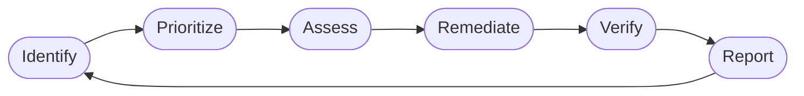
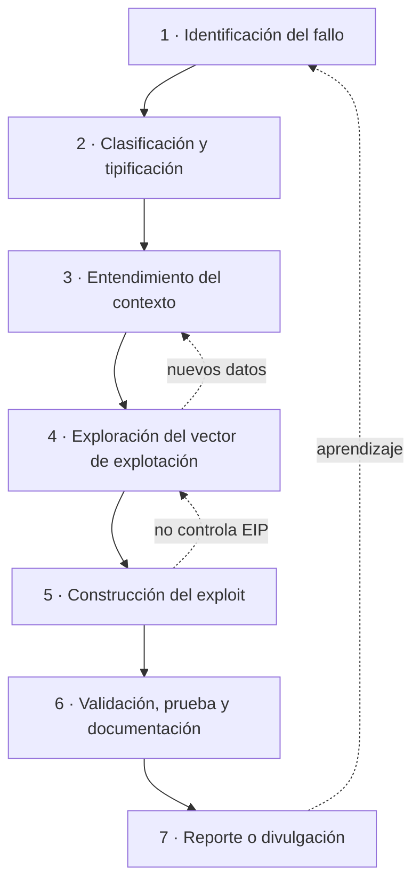

# 1. Metodología de análisis de vulnerabilidades

> *"No se espera de ti únicamente que ejecutes exploits públicos; se espera que
> seas capaz de construir una metodología sólida de análisis."* — enunciado del Módulo 6.

Este capítulo es mi forma de abordar una vulnerabilidad. No una receta cerrada,
sino el marco con el que decido qué mirar, con qué herramienta y en qué orden,
asumiendo que las fases se pisan unas a otras y casi nunca van en línea recta.

## 1.1. Qué entiendo por vulnerabilidad

Una vulnerabilidad es una desviación entre lo que el código hace y lo que el
modelo de seguridad esperaba que hiciera. Por sí sola no es una amenaza; es una
puerta que puede o no abrirse. Para que se convierta en un problema real tienen
que darse varias cosas a la vez: una vía de interacción con el componente, la
posibilidad de manipular las estructuras que disparan el fallo, y un entorno
cuyas protecciones se puedan sortear.

Esa distinción, entre que un fallo exista y que sea explotable, es la que ordena
todo lo que viene después. Encontrar un `strcpy` sin control no tiene mérito;
demostrar que ese `strcpy` te da el control del flujo con ASLR, DEP y canary
puestos es el trabajo de verdad.

Las familias que más me interesan son las que reaparecen en software real:

- Desbordamientos de búfer (stack / heap): corrupción de memoria.
- Use-After-Free: uso de memoria ya liberada.
- Validación de entrada deficiente: inyecciones de comandos, SQL, formato.
- Gestión indebida de privilegios: escaladas.

## 1.2. Dónde encaja el análisis

El análisis no vive solo. Está dentro de un ciclo de gestión de vulnerabilidades
más amplio, que va desde que el fallo aparece hasta que se corrige y se comprueba
que se ha cerrado.

Mi foco como analista está en Identify → Assess. Pero como lo que quiero es
trabajar en Blue Team, no me vale quedarme ahí: tengo que pensar también en
Remediate → Verify. Encontrar el fallo sin saber cómo se detecta ni cómo se
confirma que está parcheado es media tarea.

## 1.3. Las 7 fases

Estas son las fases que sigo en cada caso. Las dibujo en bucle a propósito,
porque un hallazgo tardío casi siempre me obliga a volver atrás.

**1 — Identificación del fallo.** Todo arranca al detectar algo que no se
comporta como debería. Puede salir de un fuzzer que genera entradas hasta
provocar un crash, de leer el código o el binario, de comparar dos versiones
para ver qué parcheó la última, o de fuentes públicas (CVE, NVD, Exploit-DB,
foros). Un crash, de entrada, solo es una hipótesis: queda confirmar que detrás
hay una vulnerabilidad. Esta fase no termina hasta que tengo un caso que puedo
reproducir cuando quiera.

**2 — Clasificación y tipificación.** Decido qué clase de fallo es, porque eso
determina las herramientas y las protecciones con las que voy a pelear. ¿Stack o
heap overflow? ¿UAF? ¿Inyección? ¿Escalada? Lo mapeo a su CWE, que me da
vocabulario común y pistas sobre cómo se ha explotado algo parecido antes.

**3 — Entendimiento del contexto.** Un fallo aislado dice poco. Me pregunto qué
versión está afectada, en qué SO y arquitectura corre (x86-32 y x86-64 no son el
mismo juego: cambia EIP por RIP y la convención de llamada), qué protecciones
hay activas, con qué privilegios parte el atacante y cuál es la superficie
—remota, local, autenticada—.

**4 — Exploración del vector.** La parte técnica de verdad. Miro registros,
volcados de memoria, depuro en vivo. Anoto el estado de la pila, el contenido de
los registros, por dónde pasan los punteros. Reproduzco el fallo de forma
controlada hasta entender qué entradas lo disparan y cómo permite tocar el flujo
de ejecución.

**5 — Construcción del exploit.** Con el fallo claro, lo convierto en algo útil:
calcular el offset exacto para sobrescribir lo que quiero, meter el payload
(msfvenom, shellcode propio, ret2win), sortear las protecciones (ROP, ret2libc)
e iterar hasta que sea fiable. Un exploit que funciona una de cada tres veces no
está terminado.

**6 — Validación y documentación.** Comprobar que funciona en más de una
configuración, confirmar que consigo lo que buscaba, y escribir el informe:
vector, condiciones, impacto y mitigaciones. Reproducible, o no vale.

**7 — Reporte o divulgación.** Según el contexto: aviso responsable al
fabricante, publicación de CVE o write-up, informe con PoC. A veces la PoC
demuestra el control sin llegar a un exploit completo.

## 1.4. Lo que no cabe en un diagrama

Las fases son el esqueleto. Lo que las hace funcionar es la cabeza con la que las
recorres. Lo que intento tener presente:

- Entender antes que ejecutar. Un exploit público que funciona pero que no sé por
  qué funciona me deja vendido el día que cambia una versión o se activa una
  protección.
- Pensar en patrones. Cada caso que analizo va a un catálogo mental de "olores a
  fallo": `strcpy`, `memcpy` con longitud del usuario, un `free` seguido de uso,
  deserialización sin validar.
- Bajar a ensamblador sin pereza. El fallo vive en los registros y en la pila. Si
  me quedo en el código fuente, no entiendo la explotación.
- Fiabilidad por encima del espectáculo. La estabilidad es parte del exploit, no
  un extra.
- Paciencia. Se combinan técnicas estáticas y dinámicas, y se vuelve atrás muchas
  veces.
- Ética de base. Nada de esto tiene sentido fuera de un marco legal y con
  autorización. La misma destreza que encuentra el fallo es la que lo reporta
  bien.

Lo que viene después aplica este marco: a las protecciones (cap. 2), a las
herramientas (cap. 3), a un caso completo (cap. 4), a CVE reales (cap. 5) y a la
investigación de 0days (cap. 6).
