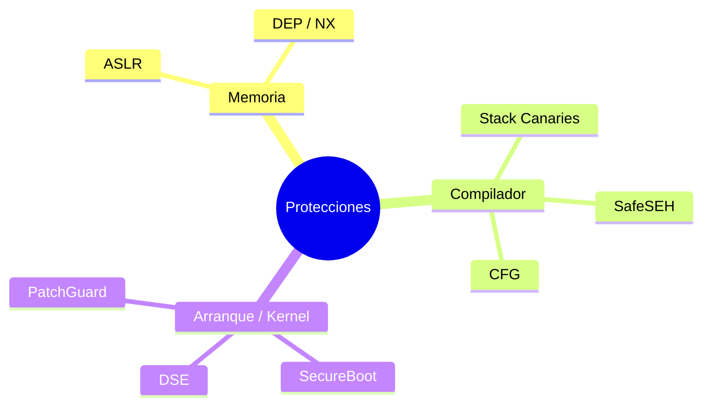

# 2. Mecanismos de protección que pueden impedir la explotación

Conocer las protecciones modernas me sirve para dos cosas: entender cómo ha ido
evolucionando la seguridad de los sistemas, y saber qué barrera concreta tengo
delante cuando analizo un fallo en un entorno controlado. Cada defensa pone un
obstáculo distinto, y casi nunca aparecen solas: se combinan, y es esa
combinación la que hace que la explotación de hoy no sea solo encontrar el fallo,
sino averiguar cómo pasar por encima de varias capas sin romper el proceso por el
camino.

La explotación clásica —desbordar la pila, meter shellcode, saltar a él— choca
hoy con varias de estas defensas a la vez. Por eso la fase 3 (contexto) siempre
incluye inventariar qué hay activo.

## 2.1. ASLR — Address Space Layout Randomization

Aleatoriza en cada ejecución dónde caen la pila, el heap, las librerías y —con
PIE— el propio ejecutable. Rompe cualquier exploit que salte a una dirección
fija, porque esa dirección ya no es la misma dos veces. Para sortearlo en
laboratorio hace falta un infoleak: una fuga que revele una dirección real en
tiempo de ejecución, a partir de la cual recalculas el resto por offset. También
sirve atacar binarios compilados sin PIE, o abusar de la baja entropía que tiene
ASLR en 32 bits.

## 2.2. DEP / NX — Data Execution Prevention / No-eXecute

Marca las zonas de datos (pila, heap) como no ejecutables. Si el flujo salta a
shellcode colocado en la pila, la CPU lanza una excepción. Esto mata la inyección
clásica de shellcode. La respuesta es no inyectar código nuevo, sino reutilizar
el que ya existe y es ejecutable: ret2libc (saltar a `system()`) o ROP (encadenar
gadgets que acaban en `ret` hasta construir la lógica que quieres).

## 2.3. Stack canaries (GS / stack cookies)

El compilador coloca un valor secreto entre las variables locales y la dirección
de retorno. Antes de `ret` comprueba que ese valor no ha cambiado; si un overflow
lo pisó, aborta con `*** stack smashing detected ***`. Esto corta el overflow
lineal "a ciegas": no llegas a la dirección de retorno sin destruir el canary por
el camino. Para pasarlo hay que filtrar su valor con un infoleak y reescribirlo
intacto, o atacar por una vía que no lo cruce (sobrescribir punteros situados
antes del canary, SEH en Windows).

## 2.4. CFG — Control Flow Guard

Protección de compilador y SO en Windows que valida, en las llamadas indirectas,
que el destino sea un punto de entrada legítimo. Complica redirigir llamadas a
través de punteros de función corruptos o vtables pisadas. Se ataca buscando
destinos que CFG dé por válidos pero que sigan siendo útiles, fallos en la propia
implementación, o vectores que no cubre —de ahí que apareciera CET con shadow
stack para cerrar el hueco de los `ret`—.

## 2.5. SafeSEH / SEHOP

Protegen el manejo de excepciones de Windows (SEH) validando que los manejadores
sean legítimos. Nacieron frente a los clásicos SEH overwrites, en los que se
pisaba la cadena de manejadores para desviar el flujo. Se sortean con módulos
compilados sin SafeSEH o con técnicas que respetan la cadena que SEHOP espera.

## 2.6. SecureBoot

Garantiza que en el arranque solo se cargue firmware, bootloader y SO firmados y
de confianza, cortando la persistencia de bootkits y rootkits con código no
firmado. Es una defensa de integridad de arranque más que de explotación en
runtime, pero define el suelo de confianza sobre el que corre todo lo demás.

## 2.7. DSE — Driver Signature Enforcement

Obliga a que los drivers de kernel estén firmados, lo que sube mucho el listón
para ejecutar código en ring 0. La vía que se usa en el mundo real es BYOVD
(Bring Your Own Vulnerable Driver): abusar de un driver legítimo, firmado pero
vulnerable, para colarse en el kernel.

## 2.8. PatchGuard (KPP)

En Windows x64, vigila que estructuras críticas del kernel (SSDT, IDT) no se
modifiquen; si detecta manipulación, provoca un BSOD. Mata el hooking de kernel
clásico de los rootkits y empuja a los atacantes hacia técnicas que no tocan lo
que está vigilado.

## 2.9. Cómo me condiciona todo esto

| Protección | Capa | Qué me bloquea | Vía de estudio para sortearla |
|------------|------|----------------|-------------------------------|
| ASLR | SO / memoria | Direcciones fijas | Infoleak → offset; binarios no-PIE |
| DEP/NX | HW + SO | Shellcode en pila | ROP / ret2libc |
| Stack canary | Compilador | Overflow lineal a EIP | Leak del canary; vectores que no lo cruzan |
| CFG | Compilador/SO | Llamadas indirectas corruptas | Destinos válidos; returns; fallos de impl. |
| SafeSEH/SEHOP | Compilador/SO | SEH overwrite | Módulos sin SafeSEH |
| SecureBoot | Firmware | Código de arranque no firmado | Integridad; fuera de runtime |
| DSE | Kernel | Drivers no firmados | BYOVD |
| PatchGuard | Kernel | Hooking de estructuras | Técnicas que no tocan lo vigilado |

Ninguna de estas protecciones hace por sí sola que un sistema sea inexpugnable.
Lo que cambia las cosas es juntarlas: la explotación pasa a ser una cadena de
problemas encadenados —primero un leak contra ASLR, luego ROP contra DEP, sin
romper el canary—, y cada capa que añades multiplica el coste del atacante. Desde
el lado defensivo (cap. 7), eso es justo lo que quiero: que ese coste sea lo más
alto posible.
