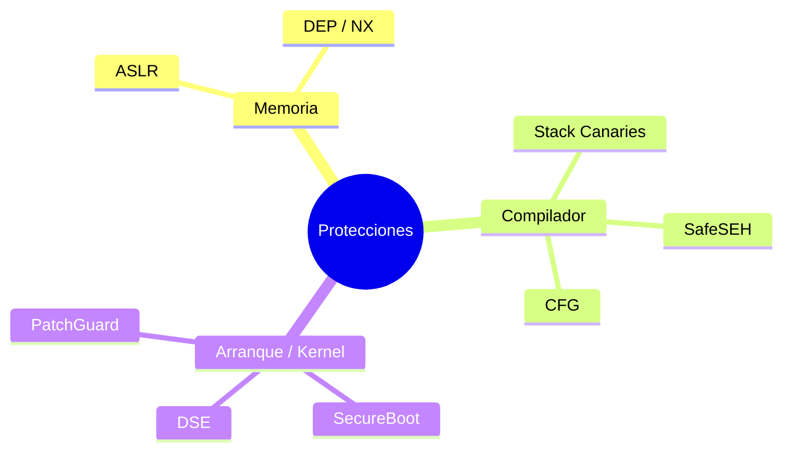

# 2. Mecanismos de protección que pueden impedir la explotación

Comprender las protecciones modernas es esencial por dos motivos: me explica **cómo ha
evolucionado la seguridad** de los sistemas, y me da el conocimiento necesario para
**analizar y, en entornos controlados, sortear** esas barreras. Cada defensa impone un
obstáculo concreto en el camino del atacante; muchas se combinan formando un ecosistema que
hace que la explotación moderna no sea solo *detectar un fallo*, sino *entender cómo pasar
por encima de estas capas sin romper el sistema en el intento*.

La explotación clásica (desbordar la pila, meter shellcode y saltar a él) hoy choca con
varias de estas defensas a la vez. Por eso la fase 3 de mi metodología (contexto) siempre
incluye inventariar **qué protecciones están activas**.

---

## 2.1. ASLR — Address Space Layout Randomization
**Qué hace:** aleatoriza la posición en memoria de la pila, el heap, las librerías y (con PIE)
el propio ejecutable, en cada ejecución.
**Qué rompe:** las direcciones *hardcodeadas*. Un exploit que salta a una dirección fija deja
de funcionar porque esa dirección cambia.
**Cómo se sortea (en entorno controlado):** con un **infoleak** —una fuga que revele una
dirección real en runtime— para recalcular el resto por *offset*; o atacando binarios/módulos
compilados **sin** PIE/ASLR. También existe el abuso de **baja entropía** en 32 bits.

## 2.2. DEP / NX — Data Execution Prevention / No-eXecute
**Qué hace:** marca regiones de datos (pila, heap) como **no ejecutables**. Si el flujo salta
a shellcode colocado en la pila, la CPU lanza una excepción.
**Qué rompe:** la inyección clásica de shellcode en la pila.
**Cómo se sortea:** **reutilizando código ya ejecutable** del propio proceso →
**ret2libc** (saltar a `system()`) o **ROP** (encadenar *gadgets* que terminan en `ret`
para construir la lógica deseada sin inyectar código nuevo).

## 2.3. Stack Canaries (GS / Stack Cookies)
**Qué hace:** el compilador coloca un valor secreto (*canary*) entre las variables locales y
la dirección de retorno. Antes de `ret`, comprueba que el canary no ha cambiado; si un
overflow lo pisó, aborta (`*** stack smashing detected ***`).
**Qué rompe:** el stack overflow lineal "ciego": no puedes llegar a la dirección de retorno
sin destruir el canary.
**Cómo se sortea:** **filtrando** el valor del canary (infoleak) para reescribirlo intacto;
o atacando por vías que no lo cruzan (sobrescritura de punteros antes del canary, SEH en
Windows, etc.).

## 2.4. CFG — Control Flow Guard
**Qué hace:** protección del compilador/SO (Windows) que valida, en las llamadas indirectas,
que el destino sea un **punto de entrada legítimo**. Dificulta redirigir llamadas por punteros
de función corruptos.
**Qué rompe:** muchas técnicas de secuestro de flujo basadas en sobrescribir punteros de
función/vtables.
**Cómo se sortea:** buscando destinos que CFG considere válidos pero útiles, fallos en la
propia implementación, o vectores que CFG no cubre (p. ej. ciertos *returns*; de ahí
evoluciones como CET/Shadow Stack).

## 2.5. SafeSEH / SEHOP
**Qué hace:** protege el mecanismo de manejo de excepciones de Windows (SEH), validando que
los manejadores sean legítimos. Nace frente a los clásicos **SEH overwrites**.
**Qué rompe:** la sobrescritura de la cadena de manejadores de excepción para desviar el flujo.
**Cómo se sortea:** módulos compilados **sin** SafeSEH, o técnicas que respetan la cadena SEHOP.

## 2.6. SecureBoot
**Qué hace:** garantiza, en el arranque, que solo se cargue firmware/bootloader/SO **firmado**
y de confianza. Protege la cadena de arranque frente a bootkits/rootkits.
**Qué rompe:** la persistencia a nivel de arranque con código no firmado.
**Relevancia:** es una defensa de **integridad de arranque**, más que de explotación en
runtime, pero define el suelo de confianza sobre el que corre todo lo demás.

## 2.7. DSE — Driver Signature Enforcement
**Qué hace:** obliga a que los **drivers** de kernel estén firmados. Eleva mucho el listón para
ejecutar código en *ring 0*.
**Qué rompe:** la carga de drivers maliciosos no firmados.
**Cómo se sortea (contexto ofensivo real):** **BYOVD** (*Bring Your Own Vulnerable Driver*):
abusar de un driver legítimo **firmado pero vulnerable** para ganar ejecución en kernel.

## 2.8. PatchGuard (KPP)
**Qué hace:** en Windows x64, vigila que estructuras críticas del kernel (SSDT, IDT, etc.) no
sean modificadas. Si detecta manipulación, provoca un BSOD.
**Qué rompe:** el *hooking* de kernel clásico de los rootkits.
**Relevancia:** empuja a los atacantes hacia técnicas que no tocan las estructuras vigiladas.

---

## 2.9. Cómo me condiciona todo esto (tabla de decisión)

| Protección | Capa | Qué me bloquea | Mi vía de estudio para sortearla |
|------------|------|----------------|----------------------------------|
| ASLR | SO / memoria | Direcciones fijas | Infoleak → cálculo por offset; binarios no-PIE |
| DEP/NX | HW + SO | Shellcode en pila | ROP / ret2libc |
| Stack Canary | Compilador | Overflow lineal a EIP | Leak del canary; vectores que no lo cruzan |
| CFG | Compilador/SO | Llamadas indirectas corruptas | Destinos válidos; returns; fallos de impl. |
| SafeSEH/SEHOP | Compilador/SO | SEH overwrite | Módulos sin SafeSEH |
| SecureBoot | Firmware | Código de arranque no firmado | (Integridad; fuera de runtime) |
| DSE | Kernel | Drivers no firmados | BYOVD |
| PatchGuard | Kernel | Hooking de estructuras | Técnicas que no tocan lo vigilado |

> **Idea clave:** ninguna protección por sí sola hace un sistema inexpugnable, pero su
> **combinación** convierte la explotación en una cadena de problemas encadenados: primero un
> leak (vs ASLR), luego ROP (vs DEP), respetando el canary... Cada capa que añades multiplica
> el coste del atacante. Esto es exactamente lo que, desde el lado defensivo (cap. 7), quiero
> maximizar.

➡️ Continúa en [3. El arsenal: herramientas por fase](03-arsenal-herramientas.md)
