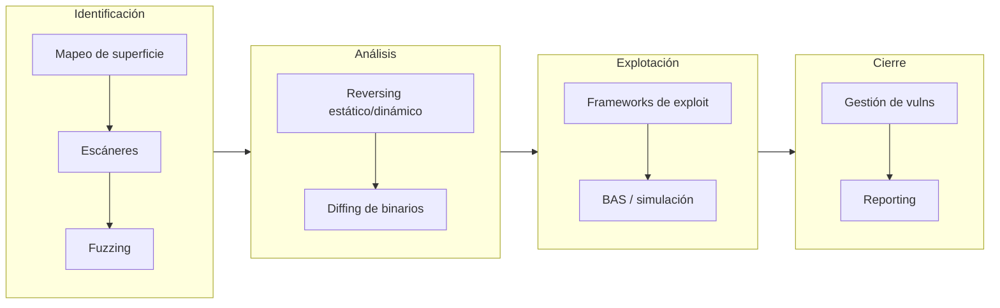

# 3. Herramientas organizadas por fase

Saber qué herramientas existen no es lo importante; lo importante es saber cuándo
usar cada una. Por eso no las pongo en un listado plano, sino situadas en la fase
donde aportan. Una herramienta fuera de su sitio te hace perder el tiempo; en el
sitio correcto, acelera el análisis.

## 3.1. Mapeo de superficie

Fase de contexto. Para saber qué hay expuesto antes de nada.

| Herramienta | Para qué la uso |
|-------------|-----------------|
| Nmap | Descubrimiento de puertos y servicios, fingerprinting. La base de todo |
| Masscan | Barridos masivos a gran velocidad en rangos grandes |
| RustScan | Descubrimiento rápido de puertos, encadenado con Nmap |
| Amass | Enumeración de subdominios y superficie externa (OSINT) |
| Sn1per | Orquestador que automatiza fases de reconocimiento |

## 3.2. Escáneres de vulnerabilidades

Para lo que ya es conocido.

| Herramienta | Nota |
|-------------|------|
| Nessus Professional | El escáner de referencia en entornos corporativos |
| Qualys | Plataforma cloud de gestión de vulnerabilidades |
| Nexpose / InsightVM | Escaneo con priorización por riesgo (Rapid7) |
| OpenVAS (Greenbone) | Alternativa open source muy completa |
| Nuclei | Escaneo por templates YAML, ideal para automatizar checks concretos |
| Vuls | Centrado en Linux y servidores |

Los escáneres encuentran lo conocido, lo que tiene firma. No descubren 0days;
para eso están el fuzzing, el reversing y el diffing. Confundir "pasé un Nessus"
con "analicé la seguridad" es el error de junior que no quiero cometer.

## 3.3. Gestión de vulnerabilidades

Faraday, DefectDojo y ArcherySec centralizan hallazgos de varias herramientas,
deduplican y dejan seguir el ciclo de vida de cada vulnerabilidad. Encajan con la
parte Remediate → Verify del ciclo, y en un SOC se valoran.

## 3.4. Frameworks de explotación

| Herramienta | Nota |
|-------------|------|
| Metasploit | El estándar: módulos de exploit, payloads, post-explotación |
| Core Impact | Comercial, pentest profesional guiado (Fortra) |
| Exploit Pack | Framework modular de exploits |
| Empire | Post-explotación y C2 |

Imprescindible al lado: msfvenom, para generar payloads y lidiar con bad
characters y codificación.

## 3.5. Breach & Attack Simulation

Caldera (MITRE), Atomic Red Team, Infection Monkey, AttackIQ y Cymulate simulan
TTPs de adversario de forma automatizada y controlada. Me interesan por partida
doble: validan si una técnica funcionaría en un entorno y, desde el lado SOC, me
dicen si mi detección salta. Atomic Red Team, mapeado a MITRE ATT&CK, es con el
que cierro el círculo ofensiva–defensa.

## 3.6. Fuzzing

| Herramienta | Nota |
|-------------|------|
| AFL++ | Fuzzer guiado por cobertura, la referencia en Linux |
| WinAFL | Port de AFL para binarios Windows |
| boofuzz | Fuzzing de protocolos de red (sucesor de Sulley) |
| Radamsa | Mutador de entradas sencillo y potente para dumb fuzzing |

El `fuzzer.py` del laboratorio es la versión mínima de esta idea: generar
entradas y detectar el umbral del fallo. Para binarios reales escalo a AFL++
(cobertura) o boofuzz (red).

## 3.7. Ingeniería inversa

| Herramienta | Uso principal |
|-------------|---------------|
| Ghidra (NSA) | Descompilador y desensamblador, gratis y muy capaz |
| IDA Free / Pro | El estándar comercial de desensamblado |
| Cutter (Rizin) | Front-end moderno y cómodo |
| x64dbg | Depurador dinámico en Windows |
| GDB (+ GEF/pwndbg) | Depuración dinámica en Linux; el que uso en el laboratorio |

## 3.8. Diffing de binarios

BinDiff y Diaphora comparan dos versiones de un binario —por ejemplo antes y
después de un parche— y resaltan las funciones que cambiaron. Es la técnica reina
del patch diffing: un Patch Tuesday de Microsoft, comparado, suele revelar el
fallo exacto que se corrigió, y de ahí salen muchos 1-day exploits.

## 3.9. Reporting

PwnDoc y Faction ayudan a generar informes técnicos reproducibles. Un hallazgo
sin un buen informe pierde la mitad de su valor, y la tarea lo pide con esas
palabras: demostrar la capacidad de comunicar los hallazgos de forma profesional
y útil.

## 3.10. Lo mínimo para arrancar un caso

Si tuviera que quedarme con un set reducido, es el que uso en el laboratorio:

- Descubrir: Nmap y, para binarios, `file`, `checksec`, `strings`, `nm`, `objdump`.
- Fuzzear: mi `fuzzer.py`, y AFL++ cuando el caso crece.
- Analizar: GDB con GEF/pwndbg (dinámico) y Ghidra (estático).
- Calcular y explotar: pwntools (`cyclic`, `process`, ROP) y msfvenom.
- Documentar: Markdown y capturas, como este repositorio.

La herramienta no sustituye al criterio. Un `objdump -d` y un GDB bien usados
resuelven más que diez escáneres lanzados sin entender la salida.
