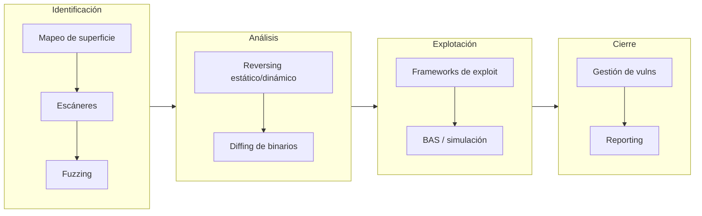

# 3. El arsenal: herramientas organizadas por fase

Conocer herramientas no es el objetivo; **saber cuándo usar cada una** sí lo es. Por eso no
presento un catálogo plano, sino un mapa de **qué herramienta aporta en qué fase** de mi
metodología. Una herramienta mal situada hace perder tiempo; bien situada, acelera el análisis.

---

## 3.1. Identificación de activos y mapeo de superficie
*Fase: contexto / superficie de ataque.*

| Herramienta | Para qué la uso |
|-------------|-----------------|
| **Nmap** | Descubrimiento de puertos/servicios y *fingerprinting*; la base de todo mapeo |
| **Masscan** | Barridos masivos a gran velocidad en rangos grandes |
| **RustScan** | Descubrimiento rápido de puertos que encadena con Nmap |
| **Amass** | Enumeración de subdominios / superficie externa (OSINT) |
| **Sn1per** | Orquestador que automatiza fases de reconocimiento |

## 3.2. Escáneres de vulnerabilidades
*Fase: identificación (vulnerabilidades conocidas).*

| Herramienta | Nota |
|-------------|------|
| **Nessus Professional** | Escáner de referencia en entornos corporativos |
| **Qualys** | Plataforma cloud de gestión de vulnerabilidades |
| **Nexpose / InsightVM** (Rapid7) | Escaneo + priorización por riesgo |
| **OpenVAS** (Greenbone) | Alternativa open source muy completa |
| **Nuclei** | Escaneo basado en *templates* YAML; ideal para automatizar checks concretos |
| **Vuls** | Escáner de vulnerabilidades centrado en Linux/servidores |

> Los escáneres encuentran lo **conocido** (CVE con firma). No descubren 0days: para eso están
> el fuzzing, el reversing y el diffing. Confundir "pasé un Nessus" con "analicé la seguridad"
> es un error de junior que quiero evitar.

## 3.3. Software de gestión de vulnerabilidades
*Fase: contexto y seguimiento.*

**Faraday**, **DefectDojo** y **ArcherySec** centralizan hallazgos de múltiples herramientas,
deduplican y permiten seguir el ciclo de vida de cada vulnerabilidad. Encajan con la parte
*Remediate → Verify* del ciclo de gestión y son muy valorados en un entorno SOC.

## 3.4. Frameworks de explotación
*Fase: construcción del exploit.*

| Herramienta | Nota |
|-------------|------|
| **Metasploit Framework** | El estándar: módulos de exploit, payloads, *post-explotación* |
| **Core Impact** (Fortra) | Comercial, orientado a pentest profesional guiado |
| **Exploit Pack** | Framework modular de exploits |
| **Empire** | Post-explotación y C2 (Command & Control) |

Complemento imprescindible: **msfvenom** para generar payloads/shellcodes y manejar
*bad characters* y codificación.

## 3.5. Breach & Attack Simulation (BAS)
*Fase: validación / perspectiva defensiva.*

**Caldera** (MITRE), **Atomic Red Team**, **Infection Monkey**, **AttackIQ** y **Cymulate**
simulan TTPs de adversario de forma automatizada y controlada. Me interesan doblemente:
validan si un exploit/una técnica funcionaría en un entorno, y —desde el lado SOC— permiten
**comprobar si mi detección se dispara**. Atomic Red Team, mapeado a MITRE ATT&CK, es mi
favorito para cerrar el círculo ofensiva↔defensa.

## 3.6. Fuzzing
*Fase: identificación del fallo (descubrimiento).*

| Herramienta | Nota |
|-------------|------|
| **AFL++** | Fuzzer guiado por cobertura, referencia en Linux |
| **WinAFL** | Port de AFL para binarios Windows |
| **boofuzz** | Fuzzing de **protocolos de red** (sucesor de Sulley) |
| **Radamsa** | Mutador de entradas sencillo y potente para *dumb fuzzing* |

Mi `fuzzer.py` del laboratorio es la versión mínima de esta idea: generar entradas y detectar
el umbral de fallo. Para binarios reales, escalo a AFL++ (cobertura) o boofuzz (red).

## 3.7. Ingeniería inversa (estático y dinámico)
*Fase: exploración del vector / análisis del crash.*

| Herramienta | Uso principal |
|-------------|---------------|
| **Ghidra** (NSA) | Descompilador + desensamblador, gratuito y potentísimo |
| **IDA Free / IDA Pro** | El estándar comercial de desensamblado |
| **Cutter** (Rizin) | Front-end moderno y cómodo para reversing |
| **x64dbg** | Depurador dinámico en Windows |
| **GDB** (+ GEF/pwndbg) | Depuración dinámica en Linux; el que uso en el laboratorio |

## 3.8. Diffing de binarios / patch diffing
*Fase: identificación (a partir de parches).*

**BinDiff** y **Diaphora** comparan dos versiones de un binario (p. ej. antes/después de un
parche) y resaltan las funciones que cambiaron. Es la técnica reina para el **patch diffing**:
un *Patch Tuesday* de Microsoft, comparado, suele revelar el fallo exacto que se corrigió →
base de muchos **1-day exploits**.

## 3.9. Reporting orientado a vulnerabilidades
*Fase: documentación y reporte.*

**PwnDoc** y **Faction** ayudan a generar informes técnicos reproducibles y profesionales.
Un hallazgo sin un buen informe pierde la mitad de su valor: la tarea pide, literalmente,
demostrar *"tu habilidad para comunicar los hallazgos de forma profesional y útil"*.

---

## 3.10. Mi *stack* mínimo para empezar un caso

Si tuviera que quedarme con un set reducido y reproducible (el que uso en el laboratorio):

- **Descubrir:** Nmap, y para binarios → `file`, `checksec`, `strings`, `nm`, `objdump`.
- **Fuzzear:** mi `fuzzer.py` → AFL++ cuando crece.
- **Analizar:** GDB + GEF/pwndbg (dinámico), Ghidra (estático).
- **Calcular/explotar:** `pwntools` (`cyclic`, `process`, ROP), msfvenom.
- **Documentar:** Markdown + capturas (este mismo repositorio).

> La herramienta no sustituye al criterio. Un `objdump -d` + GDB bien usados resuelven más que
> diez escáneres lanzados sin entender la salida.

➡️ Continúa en [4. Caso práctico: del fallo al exploit](04-caso-practico.md)
