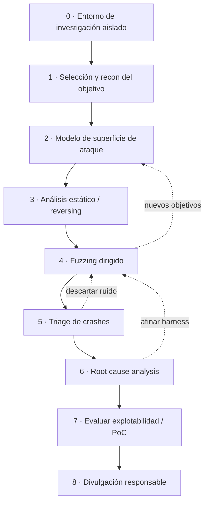

# 6. Mi aproximación a los 0days

Un 0day es una vulnerabilidad que nadie ha divulgado, reportado ni parcheado
todavía. No hay CVE, ni firma de escáner, ni write-up que seguir: hay que
identificar el fallo, entender su causa raíz, medir su impacto y, si procede,
construir una PoC que demuestre que es explotable, partiendo de cero.

Lo que describo aquí es cómo sería mi flujo ante un objetivo del que no conozco
ningún fallo previo. La pregunta que lo guía todo es sencilla de enunciar y
difícil de responder: qué entrada, procesada por qué código, podría cruzar qué
validación que falta.

## 6.0. El entorno, lo primero

Investigar 0days pide un laboratorio aislado. Mi base:

- VM dedicada y aislada, con snapshots para volver atrás después de cada crash.
  Red host-only o sin red.
- Instrumentación de memoria: si hay fuente, compilar el objetivo con ASan/UBSan
  para que los errores de memoria salten al momento y con contexto.
- Depuradores: GDB con GEF/pwndbg en Linux, x64dbg o WinDbg en Windows.
- Reversing: Ghidra, IDA o Cutter para el estático.
- Fuzzers: AFL++ (cobertura), libFuzzer (por función), boofuzz (protocolos),
  Radamsa (mutación rápida).
- Control de versiones de los harness, el corpus y las notas, porque la
  investigación es iterativa y hay que poder reproducir cada paso.

Un crash que no sé reproducir no vale nada, así que sin entorno reproducible no
hay investigación seria.

## 6.1. Selección y reconocimiento

Elijo objetivos donde pueda aportar y aprender: open source con superficie de
parsing (formatos de fichero, protocolos), componentes poco auditados, o binarios
de un reto. En el recon inicial miro el lenguaje y el toolchain (C/C++ apunta a
errores de memoria; Java/.NET a inyección y deserialización; web a lógica e
inyección), si hay fuente o solo binario —eso decide si empiezo por estático puro
o por reversing—, qué protecciones trae por defecto, y el historial de CVE del
proyecto: donde ya ha fallado antes, suele volver a fallar.

## 6.2. Modelo de superficie de ataque

Dibujo por dónde entran los datos y quién los procesa, pensando como un mapa de
flujo: puntos de entrada (ficheros, red, formularios, APIs, IPC, argumentos,
variables de entorno), los parsers y funciones que tocan memoria sensible (copias,
cálculos de tamaño, allocations, frees, deserialización), y qué validaciones hay
y en qué orden se aplican. El objetivo es priorizar: concentrar el esfuerzo donde
coinciden entrada controlable, código complejo y poca validación. Ahí es donde
viven los 0days.

## 6.3. Análisis estático / reversing

Antes del fuzzing o en paralelo, leo el código o el desensamblado buscando los
olores a fallo del catálogo: `strcpy`, `strcat`, `sprintf`, `memcpy`/`memmove`
con longitud del usuario; aritmética de tamaños o índices (riesgo de integer
overflow que lleva a under-allocation y de ahí a heap overflow); un `free` con uso
posterior del puntero, o un doble `free`; deserialización, `eval`, plantillas y
lookups (la confusión datos/código estilo Log4Shell); y comprobaciones de límites
ausentes o hechas después de usar el dato. Con Ghidra marco las funciones
candidatas y las dejo apuntadas para dirigir el fuzzing hacia ellas.

## 6.4. Fuzzing dirigido

El fuzzing es mi motor de descubrimiento, pero dirigido por lo que vi en el
reversing, no a ciegas. Preparo un harness que aísla la función o la entrada
objetivo para fuzzearla rápido (libFuzzer por función, AFL++ para el binario
completo). Parto de un corpus semilla de entradas válidas y variadas —ficheros
reales del formato, capturas de tráfico— para que el fuzzer arranque ejercitando
código de verdad. Dejo que AFL++ guíe la mutación por cobertura hacia ramas
nuevas, con los sanitizers puestos para que un out-of-bounds de 1 byte ya provoque
un abort con diagnóstico en vez de pasar desapercibido. Y uso diccionarios con
tokens del formato para superar los parsers más estrictos.

Mi `fuzzer.py` del laboratorio es la versión conceptual mínima de todo esto; aquí
escalo a herramientas con cobertura y mutación inteligente.

## 6.5. Triage de crashes

Un fuzzer suelta muchos crashes, y la mayoría son duplicados o ruido. El triage
separa el grano: deduplicar por stack trace o hash de la pila de llamadas,
minimizar el caso con `afl-tmin` hasta la entrada más pequeña que reproduce el
fallo, y clasificar la severidad —¿lectura o escritura?, ¿controlo la dirección o
el valor?—. Una escritura OOB con offset controlado vale mucho más que una lectura
nula. Herramientas de análisis de crash ayudan a estimar el potencial.

## 6.6. Root cause analysis

Aquí está la diferencia entre "tengo un crash" y "entiendo la vulnerabilidad".
Depuro el caso minimizado para responder qué instrucción falla y por qué, qué
estructura de memoria se corrompe, cuánto controlo (offset, tamaño, contenido,
dirección), si la causa es un cálculo de tamaño, un off-by-one, un UAF o una
validación ausente, y si es alcanzable de forma fiable desde la superficie de
entrada real. El resultado es una descripción causal del fallo, no un "peta
aquí". Esa comprensión es la que decide si hay exploit o solo un DoS.

## 6.7. Evaluar explotabilidad y PoC

Con la causa clara, mido el impacto contra las protecciones del objetivo (cap. 2):
si puedo convertir la corrupción en control de flujo (EIP/RIP) o en control de
datos (un write-what-where), y qué necesito para sortear el entorno —normalmente
un infoleak contra ASLR, ROP contra DEP y un leak del canary si lo hay—. Construyo
una PoC que demuestre la explotabilidad de forma reproducible; a veces basta con
una PoC que pruebe el control, sin un exploit weaponizado completo. Prioridad a la
fiabilidad y la claridad: una PoC entendible y reproducible es lo que deja al
fabricante confirmar y corregir el fallo.

## 6.8. Divulgación responsable

Encontrar un 0day trae una responsabilidad. Mi criterio: avisar primero al
fabricante y darle un plazo razonable para parchear antes de publicar; nada de
venderlo en mercados grises ni usarlo fuera de un marco autorizado; si hay bug
bounty, seguir sus reglas; y publicar el write-up técnico cuando el parche esté
disponible, que aporta a la comunidad y construye una reputación honesta.

## 6.9. Las cuatro técnicas del enunciado

| Técnica | Dónde encaja | Herramientas |
|---------|--------------|--------------|
| Fuzzing | 6.4, descubrimiento dirigido | AFL++, libFuzzer, boofuzz, Radamsa |
| Diffing | 1-day, entender parches | BinDiff, Diaphora, Ghidra |
| Reversing | 6.3 estático + 6.6 root cause | Ghidra, IDA, Cutter, GDB/x64dbg |
| Entorno | 6.0, base de todo | VM aislada, ASan, snapshots, depuradores |

El diffing merece un apunte. Aunque el enunciado lo asocia a 0days, su uso más
directo es encontrar 1-days: comparar un binario antes y después de un parche para
deducir el fallo que se corrigió y explotar a quien aún no ha actualizado. Es la
cara complementaria del 0day y usa el mismo músculo.

Mi aproximación a un 0day es, en el fondo, un embudo: de una superficie amplia a
un fallo concreto, entendido en su causa y medido contra las protecciones reales,
sostenido por un entorno reproducible y cerrado con divulgación responsable. La
misma metodología del capítulo 1, llevada al escenario más difícil: cuando no hay
ningún mapa previo.
