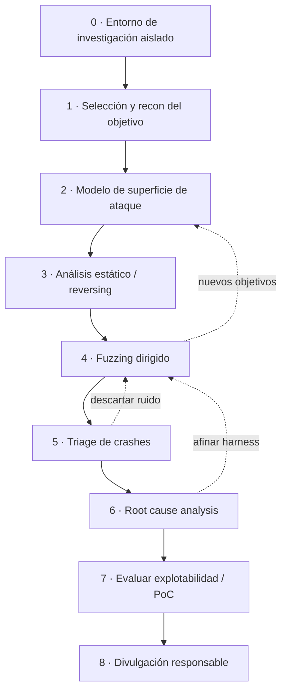

# 6. Mi aproximación a los 0days

Un **0day** es una vulnerabilidad **desconocida**: aún no ha sido divulgada, reportada ni
parcheada. No hay CVE, ni firma de escáner, ni write-up que seguir. El analista debe
**identificar el fallo, entender su causa raíz, determinar su impacto y, si procede,
desarrollar una PoC** que evidencie la explotabilidad — partiendo de cero.

Aquí describo **cómo sería mi flujo de investigación** ante un objetivo del que no conozco
ningún fallo previo. La pregunta que lo guía todo es: *¿qué entrada, procesada por qué código,
podría cruzar qué validación ausente?*

---

## 6.0. El entorno: lo primero de todo

Investigar 0days **exige un laboratorio aislado**. Mi setup base:

- **VM dedicada y aislada** (snapshots para volver atrás tras cada crash). Red *host-only* o sin red.
- **Instrumentación de memoria:** compilar el objetivo (si hay fuente) con **ASan/UBSan**
  (AddressSanitizer) para que los errores de memoria salten de inmediato y con contexto.
- **Depuradores:** GDB + **GEF/pwndbg** (Linux), **x64dbg**/WinDbg (Windows).
- **Reversing:** **Ghidra** / IDA / Cutter para el análisis estático.
- **Fuzzers:** **AFL++** (cobertura), **libFuzzer** (por función), **boofuzz** (protocolos),
  **Radamsa** (mutación rápida).
- **Control de versiones** de mis *harness*, *corpus* y notas: la investigación es iterativa y
  hay que poder reproducir cada paso.

> Sin entorno reproducible no hay investigación seria: un crash que no sé reproducir no vale nada.

---

## 6.1. Selección y reconocimiento del objetivo

Elijo objetivos donde pueda **aportar y aprender**: software open source con superficie de
parsing (formatos de fichero, protocolos), componentes poco auditados, o binarios de un reto.
Recon inicial:

- ¿Qué **lenguaje** y *toolchain*? (C/C++ → errores de memoria; Java/.NET → inyección,
  deserialización; web → lógica, inyección).
- ¿Hay **código fuente** o solo binario? Define si empiezo por estático puro o por reversing.
- ¿Qué **protecciones** trae por defecto? (checksec / propiedades del binario).
- **Historial de CVEs** del proyecto: dónde ha fallado antes suele volver a fallar (patrones).

---

## 6.2. Modelo de superficie de ataque

Dibujo **por dónde entran los datos** y **quién los procesa**. Esta es la fase donde pienso como
un mapa de flujo de datos:

- Puntos de entrada: ficheros, paquetes de red, formularios, APIs, IPC, argumentos, variables
  de entorno, dispositivos.
- *Parsers* y funciones que tocan memoria sensible: copias, cálculos de tamaño, *allocations*,
  *frees*, deserialización.
- Qué validaciones (si las hay) se aplican y en qué orden.

El objetivo es **priorizar**: concentrar el esfuerzo donde entrada controlable + código
complejo + poca validación coinciden. Ahí es donde viven los 0days.

---

## 6.3. Análisis estático / reversing

Antes (o en paralelo) al fuzzing, leo el código o el desensamblado buscando los *olores a fallo*
de mi catálogo mental:

- `strcpy`, `strcat`, `sprintf`, `memcpy`/`memmove` con longitud controlada por el usuario.
- Aritmética de tamaños/índices (riesgo de *integer overflow* → under-allocation → heap overflow).
- `free` y uso posterior del puntero (UAF), doble `free`.
- Deserialización, `eval`, plantillas, *lookups* (confusión datos↔código, estilo Log4Shell).
- Comprobaciones de límites ausentes o hechas **después** de usar el dato.

Con **Ghidra** marco funciones candidatas y las anoto como objetivos para dirigir el fuzzing.

---

## 6.4. Fuzzing dirigido

El fuzzing es mi motor de descubrimiento, pero **dirigido** por lo aprendido en el reversing,
no a ciegas:

- **Harness:** aíslo la función/entrada objetivo para fuzzearla rápido (libFuzzer por función;
  AFL++ para el binario completo).
- **Corpus semilla:** entradas válidas y variadas (ficheros reales del formato, capturas de
  tráfico), para que el fuzzer parta de algo que ya ejercita el código.
- **Cobertura:** AFL++ guía la mutación hacia ramas nuevas → encuentra fallos no obvios.
- **Sanitizers activos:** con ASan, un *out-of-bounds* de 1 byte ya provoca un abort con
  diagnóstico, en vez de pasar desapercibido.
- **Diccionarios** con tokens del formato/protocolo para superar parsers estrictos.

Mi `fuzzer.py` del laboratorio es la versión conceptual mínima de todo esto; aquí escalo a
herramientas con cobertura y mutación inteligente.

---

## 6.5. Triage de crashes

Un fuzzer produce **muchos** crashes, la mayoría duplicados o irrelevantes. El *triage* separa
el grano de la paja:

- **Deduplicar** por *stack trace* / hash de la pila de llamadas.
- **Minimizar** el caso (`afl-tmin`): reducir la entrada al mínimo que reproduce el fallo.
- **Clasificar severidad:** ¿es lectura o escritura? ¿controlo la dirección/el valor? Una
  escritura OOB con offset controlado vale mucho más que una lectura nula.
- Herramientas tipo *exploitable*/análisis de crash ayudan a estimar el potencial.

---

## 6.6. Root cause analysis (la fase que de verdad importa)

Aquí está la diferencia entre "tengo un crash" y "entiendo la vulnerabilidad". Depuro el caso
minimizado para responder:

- ¿**Qué** instrucción falla y **por qué**? ¿Qué estructura de memoria se corrompe?
- ¿**Cuánto** controlo? (offset, tamaño, contenido, dirección).
- ¿La causa es un cálculo de tamaño, un off-by-one, un UAF, una validación ausente?
- ¿Es **alcanzable** de forma fiable desde la superficie de entrada real?

El resultado es una descripción **causal** del fallo, no solo un "peta aquí". Esa comprensión es
la que decide si hay exploit o solo un DoS.

---

## 6.7. Evaluar explotabilidad y construir la PoC

Con la causa clara, evalúo el impacto real contra las protecciones del objetivo (cap. 2):

- ¿Puedo convertir la corrupción en **control de flujo** (EIP/RIP) o en **control de datos**
  (un *write-what-where*)?
- ¿Qué necesito para sortear el entorno? Normalmente un **infoleak** (vs ASLR) + **ROP**
  (vs DEP) + leak de **canary** si lo hay.
- Construyo una **PoC** que demuestre la explotabilidad de forma reproducible — a veces basta
  una PoC que pruebe el control, sin un exploit *weaponizado* completo.

> Fiabilidad y claridad por encima de espectáculo: una PoC entendible y reproducible es lo que
> permite al fabricante confirmar y corregir el fallo.

---

## 6.8. Divulgación responsable

Encontrar un 0day conlleva una **responsabilidad**. Mi criterio:

- **Responsible / coordinated disclosure:** notificar primero al fabricante, dar un plazo
  razonable para parchear antes de publicar.
- Nada de vender el fallo en mercados grises ni usarlo fuera de un marco autorizado.
- Si hay programa de **bug bounty**, seguir sus reglas.
- Publicar un **write-up** técnico cuando el parche esté disponible: aporta a la comunidad y
  construye reputación profesional honesta.

---

## 6.9. Las cuatro técnicas que pide el enunciado, en una tabla

| Técnica | Dónde encaja en mi flujo | Herramientas |
|---------|--------------------------|--------------|
| **Fuzzing** | 6.4 descubrimiento dirigido | AFL++, libFuzzer, boofuzz, Radamsa |
| **Diffing** | 1-day / entender parches del objetivo | BinDiff, Diaphora, Ghidra |
| **Reversing** | 6.3 estático + 6.6 root cause | Ghidra, IDA, Cutter, GDB/x64dbg |
| **Entorno** | 6.0 base de todo | VM aislada, ASan, snapshots, depuradores |

El **diffing** merece una nota: aunque el enunciado lo asocia a 0days, su uso más directo es
encontrar **1-days** — comparar un binario antes/después de un parche para deducir el fallo que
se corrigió y explotar a quien aún no ha actualizado. Es la cara complementaria del 0day y usa
el mismo músculo analítico.

> **Síntesis:** mi aproximación a un 0day es un embudo — de una superficie amplia a un fallo
> concreto, entendido en su causa raíz y evaluado contra las protecciones reales — sostenido
> por un entorno reproducible y cerrado con divulgación responsable. Es la misma metodología del
> capítulo 1, llevada al escenario más exigente: cuando no hay ningún mapa previo.

➡️ Continúa en [7. Bastionado y defensa](07-bastionado-defensa.md)
