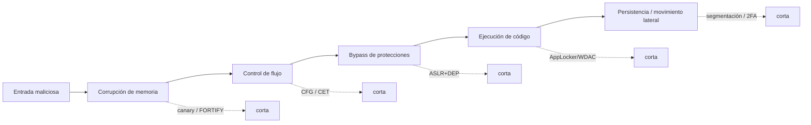
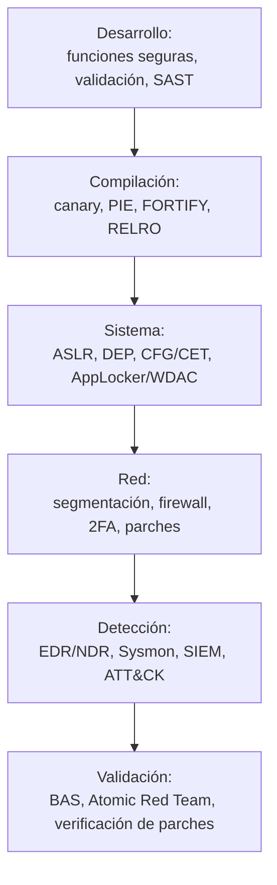

# 7. Bastionado y defensa

Entender cómo se construye un exploit no es el fin; es la mejor forma de saber
dónde romper la cadena. Bastionar no es proteger por si acaso, es cortar esa
cadena antes de que el atacante pueda avanzar. Una vulnerabilidad puede existir,
pero su impacto real depende del entorno: qué protecciones hay activas, qué
ejecución está restringida, qué tráfico se filtra y qué controles de acceso le
complican la vida.

Este capítulo es mi puente hacia el Blue Team: coger todo lo ofensivo de los
capítulos anteriores y darle la vuelta.

## 7.1. Romper la cadena

Un exploit moderno es una cadena: entrada → corrupción → control de flujo →
bypass de protecciones → ejecución → persistencia o movimiento lateral. Si rompo
un solo eslabón, el exploit falla. Bastionar es precisamente multiplicar los
eslabones que el atacante tiene que romper.

## 7.2. En desarrollo: la raíz del problema

La mejor vulnerabilidad es la que nunca llega a existir. Lo que vimos en el
laboratorio, llevado a la práctica:

- Funciones con control de tamaño: `strcpy` → `strncpy`/`strcpy_s`/`snprintf`;
  `gets` → `fgets`.
- Validar en serio toda entrada externa: tamaño, tipo, rango, frontera
  datos/código.
- Compilar con las protecciones puestas: canary (`-fstack-protector-all`), PIE
  (`-fPIE -pie`), FORTIFY (`-D_FORTIFY_SOURCE=2`), RELRO.
- SAST/DAST en el pipeline y revisión de código centrada en los olores a fallo.
- Lenguajes memory-safe (Rust, Go) donde el riesgo lo justifique.

En el laboratorio, recompilar la misma vulnerabilidad con `-fstack-protector-all`
convierte el control total de EIP en un `*** stack smashing detected ***`. Un
flag, un eslabón roto.

## 7.3. En el sistema operativo

Las defensas que como atacante quería sortear son, desde aquí, mis aliadas. Lo que
hay que vigilar es que estén activas, porque no siempre vienen por defecto en
todos los binarios:

- ASLR —idealmente con alta entropía— y DEP/NX habilitados en todo el parque.
- CFG / CET (shadow stack) donde el toolchain y el SO lo permitan.
- SecureBoot, DSE y PatchGuard en el arranque y el kernel de Windows.
- Restricción de ejecución con AppLocker o WDAC: aunque el atacante logre meter un
  payload, no podrá ejecutarlo si no cumple la política de binarios permitidos.

## 7.4. En red y configuración

- Segmentación y firewall local. Muchas herramientas de ataque dependen de
  servicios accesibles en la red interna; una RCE deja de ser viable si el puerto
  afectado no se alcanza desde donde está el atacante. Bastionar es también cerrar
  lo que no hace falta y limitar lo que sí.
- Autenticación robusta y 2FA en lo expuesto (RDP, VPN, SSH, paneles web): una
  barrera secundaria incluso si una vulnerabilidad permite un bypass parcial.
- Deshabilitar lo heredado. SMBv1 / WannaCry es el ejemplo de manual, y lo mismo
  con macros de Office que nadie usa, Telnet o scripting innecesario. Todo lo que
  no está en uso es una vía de entrada.
- Gestión de parches con validación. Mantener el sistema al día no solo cierra
  fallos conocidos, sino que reduce mucho el éxito de un exploit público. Y
  conviene tener una rutina que compruebe que el parche quedó aplicado, sobre todo
  en servicios críticos.

## 7.5. Del bastionado a la detección

El bastionado reduce la superficie; la detección asume que algo pasará de todos
modos. Como futuro analista SOC, para cada técnica ofensiva de este documento me
pregunto qué huella deja y cómo la cazo:

| Técnica ofensiva | Huella observable | Dónde la detecto |
|------------------|-------------------|------------------|
| Exploit de memoria (crash de servicio) | Crashes repetidos, core dumps, reinicios | Logs de app/SO, EDR |
| Shellcode / proceso hijo anómalo | Spawn inesperado (`w3wp.exe`→`cmd.exe`) | EDR, Sysmon (Event ID 1) |
| ROP / ejecución en zona de datos | Violaciones de DEP, anomalías de ejecución | EDR, telemetría de exploit-guard |
| C2 / exfiltración | Salidas a destinos raros, beaconing | NDR, proxy, NetFlow |
| Log4Shell / inyección | Cadenas `${jndi:`, LDAP/RMI saliente | WAF, logs, egress filtering |
| EternalBlue / SMBv1 | Tráfico SMBv1 este-oeste, patrón conocido | IDS/IPS (firmas), NDR |

Mapear cada huella a MITRE ATT&CK me deja construir detecciones ordenadas y medir
cuánta cobertura tengo. Y con Atomic Red Team o Caldera (cap. 3.5) puedo simular
la técnica en un entorno controlado y comprobar que la alerta salta, que es la
forma de cerrar el círculo entre ofensiva y defensa.

## 7.6. Defensa en capas

La defensa en profundidad no busca una muralla perfecta, sino encadenar
obstáculos de forma que el coste y el ruido del atacante suban en cada capa, y eso
me dé tiempo y señales para detectar y responder. Entender la ofensiva es lo que
me deja poner cada obstáculo donde más molesta.
