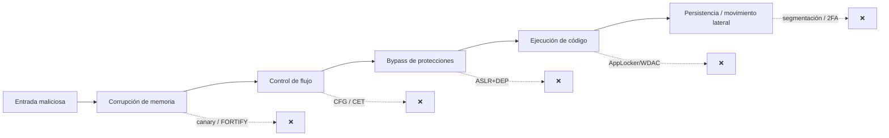
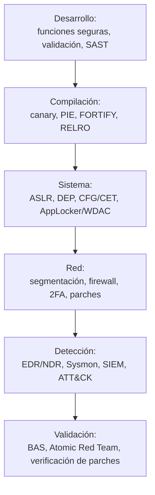

# 7. Bastionado y defensa

Entender cómo se construye un exploit no es un fin en sí mismo: es la mejor forma de saber
**cómo romper la cadena de explotación**. Bastionar no es proteger *"por si acaso"*, sino
**interrumpir esa cadena antes de que el atacante pueda avanzar**. Una vulnerabilidad puede
existir, pero su impacto real depende del entorno: protecciones habilitadas, restricciones de
ejecución, filtros de tráfico y controles de acceso que dificulten o impidan su explotación.

Este capítulo es mi puente natural hacia el **Blue Team / SOC**: cojo todo lo ofensivo de los
capítulos anteriores y lo doy la vuelta.

---

## 7.1. Romper la cadena de explotación

Un exploit moderno es una **cadena**: entrada → corrupción → control de flujo → bypass de
protecciones → ejecución → persistencia/movimiento. Si rompo **un solo eslabón**, el exploit
falla. El bastionado es, precisamente, multiplicar los eslabones que el atacante debe romper.

---

## 7.2. Medidas a nivel de desarrollo (raíz del problema)

La mejor vulnerabilidad es la que no llega a existir. Lo que vimos en el laboratorio:

- **Funciones con control de tamaño:** `strcpy` → `strncpy`/`strcpy_s`/`snprintf`; `gets` → `fgets`.
- **Validación estricta de toda entrada externa** (tamaño, tipo, rango, frontera datos/código).
- **Compilación con todas las protecciones:** canary (`-fstack-protector-all`), **PIE**
  (`-fPIE -pie`), **FORTIFY** (`-D_FORTIFY_SOURCE=2`), RELRO.
- **SAST/DAST** en el pipeline (análisis estático/dinámico) y revisión de código centrada en
  los *olores a fallo*.
- Lenguajes *memory-safe* (Rust, Go) donde el riesgo lo justifica.

> En el laboratorio, recompilar la **misma** vulnerabilidad con `-fstack-protector-all` convierte
> el control total de EIP en un `*** stack smashing detected ***`. Un flag, un eslabón roto.

---

## 7.3. Medidas a nivel de sistema operativo (las protecciones del cap. 2, en operación)

Las defensas que como atacante quería sortear son, desde aquí, mis aliadas. Hay que
**asegurarse de que están activas**, porque no siempre vienen por defecto en todos los binarios:

- **ASLR** (idealmente alta entropía) + **DEP/NX** habilitados en todo el parque.
- **CFG / CET (Shadow Stack)** donde el toolchain y el SO lo permitan.
- **SecureBoot**, **DSE** y **PatchGuard** en el arranque y el kernel de Windows.
- **Restricción de ejecución** con **AppLocker** o **WDAC** (Windows Defender Application
  Control): aunque el atacante logre introducir un payload, no podrá ejecutarlo si no cumple la
  política de binarios permitidos.

---

## 7.4. Medidas a nivel de red y configuración

- **Segmentación** y **firewall local**: muchas herramientas de ataque dependen de servicios
  accesibles en red interna. Una RCE deja de ser viable si el **puerto afectado no es accesible**
  desde donde está el atacante. *Bastionar es también cerrar lo innecesario y limitar lo
  imprescindible.*
- **Autenticación robusta + 2FA** en servicios expuestos (RDP, VPN, SSH, paneles web): actúa de
  barrera secundaria incluso si una vulnerabilidad permite un bypass parcial.
- **Deshabilitar lo heredado:** el caso **SMBv1 / WannaCry** es el ejemplo clásico. Lo mismo con
  macros de Office innecesarias, Telnet, scripting no usado. *Todo lo que no esté en uso es una
  vía de entrada potencial.*
- **Gestión de parches + validación:** mantener el sistema al día no solo cierra fallos
  conocidos, sino que reduce drásticamente el éxito de un exploit público. Establecer una
  **rutina de validación** de los parches aplicados, sobre todo en servicios críticos.

---

## 7.5. Del bastionado a la detección: la mirada SOC

El bastionado reduce la superficie; la **detección** asume que algo pasará igualmente. Como
futuro analista SOC, para cada técnica ofensiva de este documento me pregunto *"¿qué huella deja
y cómo la cazo?"*:

| Técnica ofensiva | Huella observable | Dónde la detecto |
|------------------|-------------------|------------------|
| Exploit de memoria (crash/reinicio de servicio) | Crashes repetidos, *core dumps*, reinicios | Logs de aplicación/SO, EDR |
| Shellcode / proceso hijo anómalo | *Spawn* inesperado (p. ej. `w3wp.exe`→`cmd.exe`) | EDR, Sysmon (Event ID 1) |
| ROP / ejecución en región de datos | Violaciones de DEP, anomalías de ejecución | EDR, telemetría de exploit-guard |
| C2 / exfiltración | Conexiones salientes a destinos raros, *beaconing* | NDR, proxy, NetFlow |
| Log4Shell / inyección | Cadenas `${jndi:`, LDAP/RMI saliente | WAF, logs, egress filtering |
| EternalBlue / SMBv1 | Tráfico SMBv1 este-oeste, patrón conocido | IDS/IPS (firmas), NDR |

**Mapear a MITRE ATT&CK** cada una de estas huellas me permite construir detecciones ordenadas
y medir cobertura. Y con **Atomic Red Team** / **Caldera** (cap. 3.5) puedo *simular* la técnica
en un entorno controlado y **verificar que mi alerta salta** — cerrando el círculo
ofensiva ↔ defensa.

---

## 7.6. Resumen defensivo en capas

La **defensa en profundidad** no busca una muralla perfecta, sino **encadenar obstáculos** de
forma que el coste y el ruido del atacante crezcan en cada capa, dándome tiempo y señales para
detectar y responder. Entender la ofensiva es lo que me permite poner cada obstáculo **donde de
verdad duele**.

➡️ Continúa en [8. Conclusiones](08-conclusiones.md)
